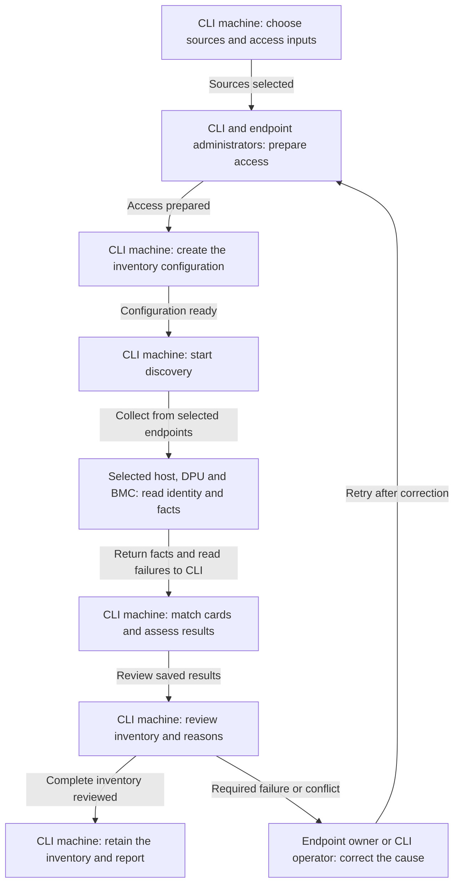
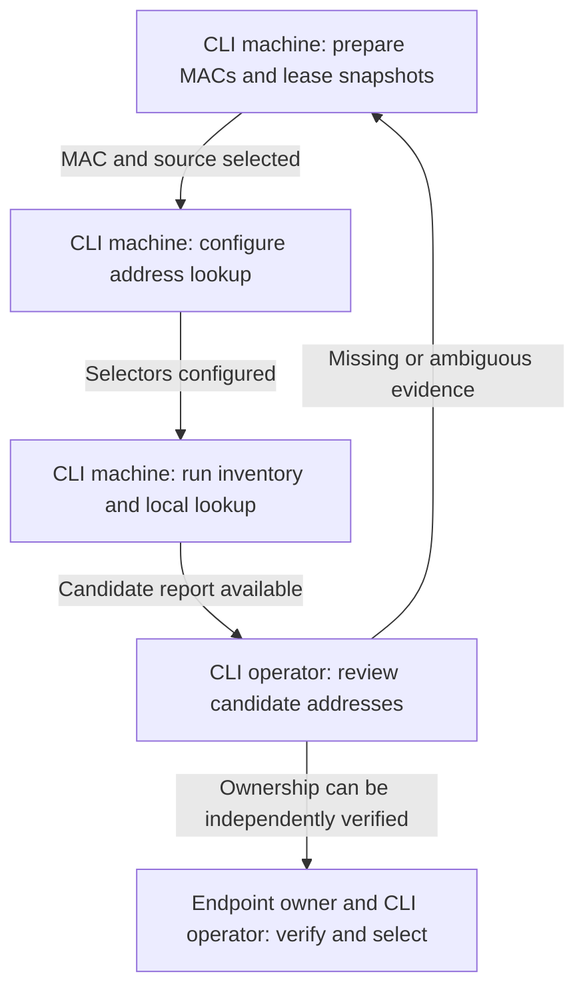
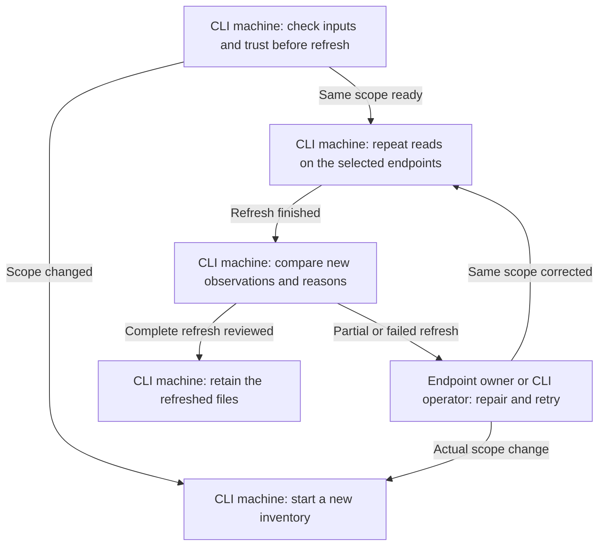
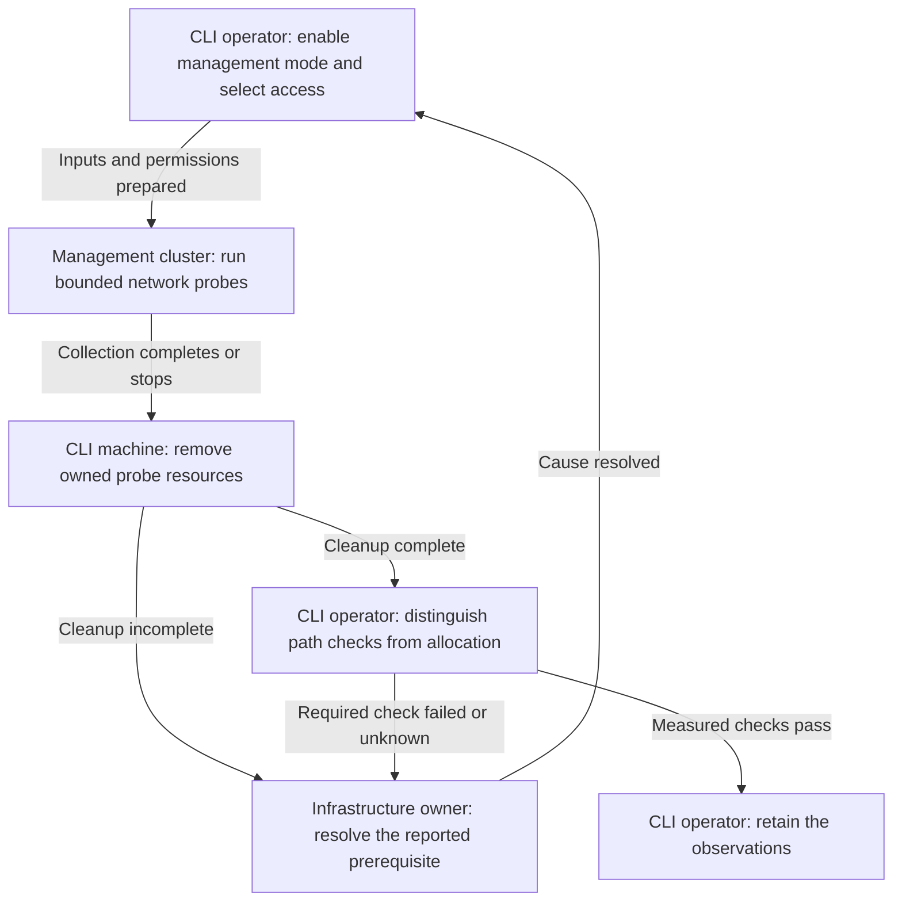
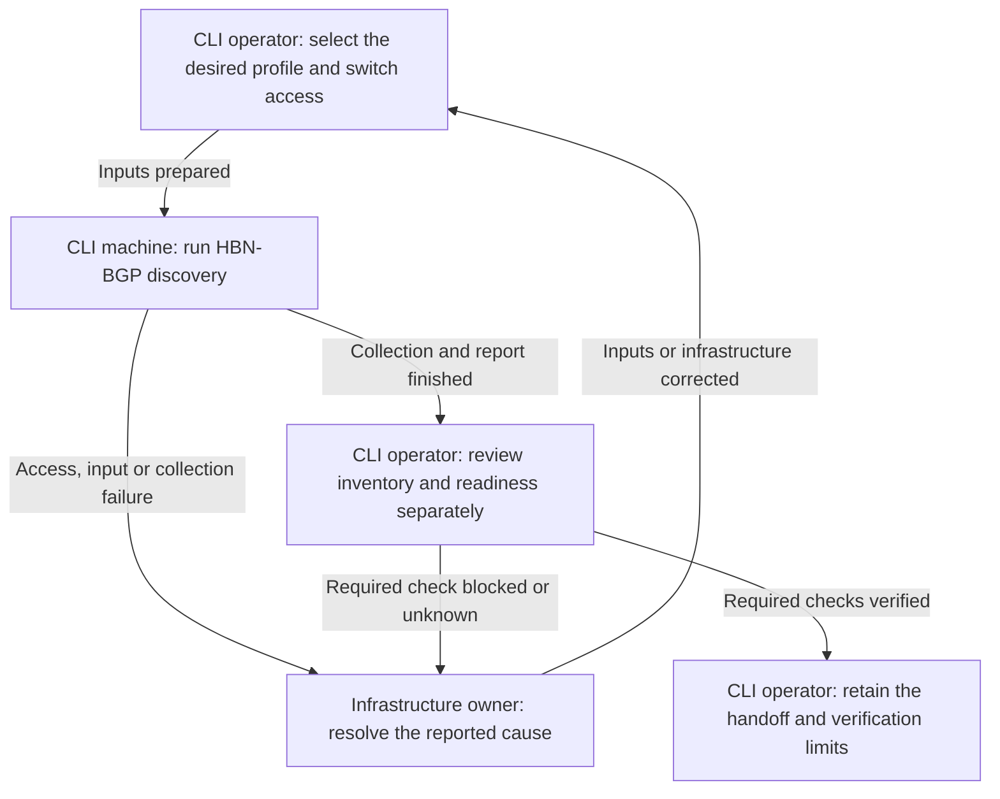
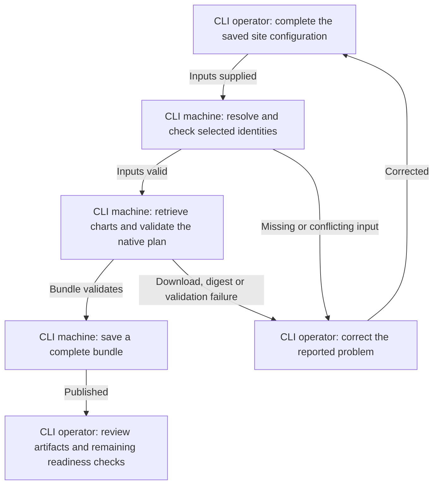
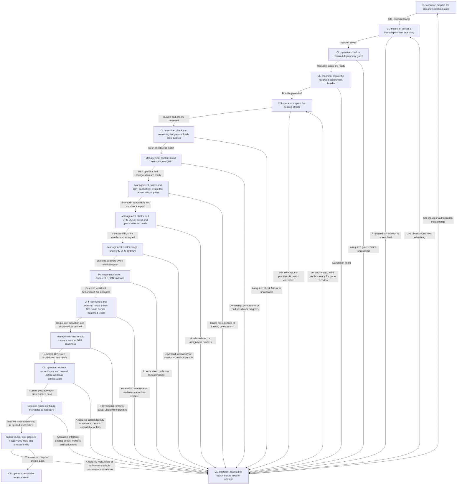

<!--
Copyright 2026 NVIDIA CORPORATION & AFFILIATES
SPDX-License-Identifier: Apache-2.0

Generated by scripts/generate-workflow-docs.py from
openspec/workflows/dpf-discovery.json. Edit the source, then regenerate.
-->

# DPF discovery, generation and deployment workflows

Use these procedures for the supported standalone DPF discovery, HBN-BGP readiness, generation and deployment workflow. The current BF4/HBN-BGP cohort remains beta; command availability does not qualify every hardware and release combination. DPF standalone validate and the composite pipeline are not available. The DPU estate is separate from Host networking. Inventory is the default; explicit management mode probes every observed node that meets the existing readiness and platform checks. Node count alone does not establish control-plane HA or qualify a production topology. Discovery collects facts and writes a handoff; it does not create VMs, install Kubernetes, change switch forwarding configuration, enroll devices or start deployment. The management Kubernetes cluster, required DPF foundations and aligned switch fabric must already exist. Deployment installs and configures DPF on that cluster, creates the selected tenant DPU cluster, provisions selected cards, configures their host workload interfaces and checks HBN traffic. Launch Kit does not create the management VM or change switch forwarding configuration.

Start with inventory, complete the HBN-BGP site inputs and readiness checks, then generate and review the bundle before the separate deployment command. Each diagram follows the procedure below it. Commands are examples for deliberate use from the CLI machine with direct access to the configured endpoints. For automation, add `--output json`, capture stdout, stderr and the process exit status separately. See the [DPF discovery reference](dpf-discovery.md) for access and output details.

## Collect the first inventory {#initial-inventory}

Use this workflow when you know the host access addresses. Explicit DPU BMC endpoints and verified administrator privileges are required for a complete inventory. Without explicit DPU endpoints, Launch Kit derives BlueField card records from host inventory and leaves their access bindings unknown; host-only or ARM-only discovery retains partial evidence and exits nonzero.



### 1. CLI machine: choose sources and access inputs {#initial-inventory-choose-inputs}

Choose each source explicitly: a host operating system over SSH or its BMC over Redfish; choose the DPU BMC over Redfish for a complete run. DPU ARM SSH is available for partial evidence but cannot verify BMC administrator privileges. A selected source must succeed; Launch Kit does not silently replace failed Redfish access with SSH. Host SSH can supply host-to-card identity in Zero Trust when PCI/VPD access is available. ARM SSH needs a booted, reachable DPU operating system. Neither access path proves trusted DPU state.

| Input | What you supply or allow Launch Kit to determine |
| --- | --- |
| Always required | At least one host endpoint and explicit DPU BMC endpoints with administrator credentials for completion; the source type; a credential alias, username, and password reference or SSH key reference for each selected endpoint. Addresses and credentials are not guessed. |
| Required for SSH | A verified `knownHostsFile`; direct connectivity from the CLI machine. SSH port defaults to `22`; ambient SSH config, agents and ProxyJump are not used. |
| Conditional | DPU ARM SSH for partial OS measurements; a private CA for Redfish when system trust is insufficient; `systemURI` if a BMC exposes several Systems. |
| Optional | A management kubeconfig for additional observations. Inventory needs none, but an explicitly supplied kubeconfig must work. |
| Defaultable | For generic inventory, `dpf.release` defaults to `26.4.0`; HBN-BGP defaults to and requires its catalog-declared release (`26.8.0` today). Redfish certificate verification is enabled; SSH `sudo` defaults to `false`. Inventory is the default and omits temporary management-network probes. Explicit management mode requests those probes. |
| Discovered | Host/system and card identities, host-to-DPU associations, visible hardware/software/network observations, and optional local BMC address hints. |

Use an account whose own session proves its effective administrator role. If session Roles is absent, local authentication must be established by an explicit trusted local session `UserAuthenticationSource`. A current `LocalAccountAuth: Enabled` policy alone cannot prove how an existing session authenticated. Disabled local authentication and explicitly external session sources are unsupported; Fallback/LocalFirst require the explicit local session source. Missing origin plus missing Roles cannot inherit privileges from a same-named local administrator. Discovery reports unverifiable proof as partial without replacing a complete handoff.

Do not provide product versions as measured facts. The selected release supplies the software bill of materials (BOM); discovery measures installed versions separately. Omitted or null `dpf.release` uses the selected use-case or generic inventory default; an empty or unknown release is rejected. The example below pins `26.8.0` so its inventory can be reused for HBN-BGP. An existing explicit release is preserved when you select a use case; change an older release to a catalog-supported HBN-BGP release, or remove that field to use the HBN-BGP default, before the HBN-BGP readiness step.

All network connections start from the machine where you run `l8k`. Host and DPU endpoints do not need to connect to each other for this workflow.

| Connection from the CLI machine | Where the operation runs | What it provides |
| --- | --- | --- |
| SSH to the selected host | Host operating system | Host identity, installed card serials and available host/card facts |
| SSH to the selected DPU ARM address | DPU operating system | DPU identity, local hardware/network facts, and optionally its BMC address through local IPMI |
| HTTPS to a selected host or DPU BMC | That BMC's Redfish service | System/card identity, host PCI/reset information and available named DPU firmware versions |
| HTTPS to the management API, only if a kubeconfig is supplied | Existing management Kubernetes API | Cluster identity, version and nodes, plus optional storage and advertised DPF API information |
| No remote connection | CLI machine | Read input/trust/lease files, match identities, compare software requirements and save results |

Choose SSH or Redfish separately for each endpoint. Selecting host Redfish does not run tools in the host OS. Selecting DPU SSH does not log in to DPU Redfish. The [collection step](#initial-inventory-collect) lists the operations for each choice.

Next: [Sources selected](#initial-inventory-prepare).

### 2. CLI and endpoint administrators: prepare access {#initial-inventory-prepare}

Put passwords in an environment variable or a private file, and SSH private keys and known-hosts entries in files under your control. Reference them from YAML; do not put password values in command-line arguments. File references are relative to that YAML file. Verify SSH keys and Redfish CA trust through your normal provisioning process.

For SSH inventory, ask the endpoint administrator to make the required read tools and permissions available before the run. Host identity/PCI collection uses tools such as `dmidecode` and `lspci`; DPU identity additionally uses `ipmitool`. Optional hardware checks use `mlxfwmanager`, `mlxconfig`, `mlxprivhost` and `systemctl`; network checks use existing `ip`, resolver and LLDP tools where available. Tool availability and access differ between host and ARM operating systems.

Set `ssh.sudo: true` only where noninteractive elevated reads are authorized and configured. Launch Kit then uses `sudo -n`; it never prompts for a sudo password, installs tools, changes privileges or repairs device settings. Missing tools, denied permissions and unsupported or malformed outputs keep specific reason codes and explanations. Required identity failures stop a complete inventory; optional unknown observations remain visible for review.

Prepare a DPU BMC account that is enabled, unlocked and does not require a password change, with all five standard Administrator privileges. A custom role with those privileges is accepted; names alone are insufficient. Discovery verifies the session, unique matching account and linked role using read requests. Handle password changes separately before rerunning; discovery never rotates passwords or tests privileges through writes.

Passwords may use an environment reference supplied for the invocation or a `passwordRef.file` pointing to an owner-only UTF-8 password file. Environment variables are convenient for automation but can be inherited or exposed by diagnostics. File references avoid that export but remain plaintext files: keep them private and outside version control. Discovery saves references, never secret values.

Next: [Access prepared](#initial-inventory-configure).

### 3. CLI machine: create the inventory configuration {#initial-inventory-configure}

Save this example as `dpf-site.yaml`, replacing the documentation address and credential paths with your host values. It uses host SSH and DPU BMC Redfish and requires no Kubernetes cluster. Ensure the listed files exist before running.

```yaml
dpf:
  release: 26.8.0
credentials:
  host-reader:
    username: inventory
    privateKeyRef: {file: ./credentials/host-key}
  dpu-maintainer:
    username: bmc-maintainer
    passwordRef: {env: DPU_BMC_PASSWORD}
discovery:
  hosts:
    - credentialRef: host-reader
      ssh:
        address: 192.0.2.21:22
        knownHostsFile: ./credentials/known_hosts
        sudo: true
  dpus:
    - bmcEndpoint: https://192.0.2.11
      credentialRef: dpu-maintainer
```

For DPU ARM observations, use the SSH shape instead; ARM-only DPU input produces partial inventory with a nonzero exit because it cannot prove BMC administrator privileges. For Redfish, use `bmcEndpoint` and a password credential reference instead of `ssh`; see the [complete access examples](dpf-discovery.md#inputs-and-invocation). Each endpoint has exactly one access source. Plain YAML is the CLI input, not a Kubernetes object. Do not copy previously observed `inventory` facts into a new seed as user assertions.

Next: [Configuration ready](#initial-inventory-run).

### 4. CLI machine: start discovery {#initial-inventory-run}

Choose a new output path for the first run. Run from a machine that can reach every selected endpoint and read the referenced files.

```bash
l8k discover --target dpf --user-config dpf-site.yaml \
  --save-cluster-config dpf-discovered.yaml --output json \
  > discovery.json 2> discovery.log
```

Record the process exit status as well as the files. `discovery.json` contains the final result; progress and diagnostics go to `discovery.log`. The command creates its own run directory next to the requested YAML. It does not send credentials to addresses found during collection. Redfish uses a temporary login session and deletes that session; SSH runs read commands on explicitly selected endpoints.

While this command runs, Launch Kit performs the collection and matching steps below automatically. You do not need to run the listed remote commands yourself. The example contacts the host over SSH and the explicitly selected DPU BMC over Redfish. Host-only input contacts no DPU endpoint and returns partial evidence with a nonzero exit.

Watch live source/check status on stderr: RUNNING is emitted before the operation, followed by its result. Endpoint names/addresses distinguish concurrent work. To keep progress visible with JSON, redirect stdout only (`>discover.json`). Add `--log-level debug` for stage timing or `--log-level trace` for request/tool metadata; `2>discover.log` saves these messages instead of displaying them. Quiet suppresses progress.

Next: [Collect from selected endpoints](#initial-inventory-collect).

### 5. Selected host, DPU and BMC: read identity and facts {#initial-inventory-collect}

Launch Kit reads each configured endpoint using the connection you selected. Host and DPU operating-system observations use SSH on those systems; BMC observations use HTTPS Redfish; management observations use the explicit management Kubernetes API when configured. HBN-BGP discovery also inspects the selected switches over SSH. It does not change forwarding configuration; its qualified stock ASIC diagnostic briefly adjusts router SDK log verbosity. See the discovery reference for the exact supported reader and interruption limits. The CLI does not install tools or repair device settings.

Required host/card identity and DPU BMC authorization must be established for a complete inventory. Optional observations add facts when available; unavailable or unsupported reads remain visible with a reason. See the [DPF discovery reference](dpf-discovery.md) for access requirements and the specific facts each source can provide.

Next: [Return facts and read failures to CLI](#initial-inventory-match).

### 6. CLI machine: match cards and assess results {#initial-inventory-match}

Launch Kit compares physical card serials returned by the selected sources. Each explicit DPU must match exactly one adapter on one observed host. A missing serial, conflicting identity or multiple matches prevents a complete inventory; an IP address or PCI address cannot substitute for that match. With host-only input, the inventory lists host-reported BlueFields without claiming a working ARM or BMC connection. These records remain partial and fail the required DPU BMC administrator check; ARM SSH cannot bypass that requirement.

Next, the CLI compares eligible measured versions with the selected release's documented requirements. It reports unavailable measurements and unknown requirements separately from below-minimum versions. These comparisons do not install or update software.

If address lookup is configured, the CLI separately matches your supplied management MACs to local lease-file records and neighbors read from the selected SSH endpoints. These are unverified IP candidates, not card identities or host-to-DPU associations. No candidate is contacted automatically.

Finally, the CLI checks collection and session-cleanup results, compares against any previous inventory, and writes the YAML and report. Required failures produce partial output; optional gaps remain recorded even when inventory completes. All output files are written on the CLI machine.

Next: [Review saved results](#initial-inventory-inspect).

### 7. CLI machine: review inventory and reasons {#initial-inventory-inspect}

The text summary shows the selected host/DPU mappings and the required-check result. Review named facts and field-specific issues to find missing or conflicting identity and access information. Complete inventory is not deployment readiness; use the saved inventory and report as a handoff, not as approval to provision.

For structured output, inspect `discovery.outcome`, `readiness`, `errors` and the saved artifact paths. The report identifies which required check needs follow-up. Do not edit saved observations to make a check pass.

Next: [Complete inventory reviewed](#initial-inventory-finish); [Required failure or conflict](#initial-inventory-resolve).

### 8. Endpoint owner or CLI operator: correct the cause {#initial-inventory-resolve}

Use the specific recorded reason to correct the source configuration or ask the infrastructure owner to repair missing tools, permissions, credentials, connectivity or conflicting identity. Do not delete unknown observations or label them passed. Optional gaps may remain documented without blocking inventory; required source failures, identity ambiguity, cleanup or publication errors need resolution. If cleanup is uncertain, use the reported session/resource ownership evidence before any manual action. Rerun after correcting the cause.

Next: [Retry after correction](#initial-inventory-prepare).

### 9. CLI machine: retain the inventory and report {#initial-inventory-finish}

Retain the seed, discovered YAML, JSON report and stderr log together. The discovered YAML preserves configuration intent and replaces observed inventory; it is not a deployment-ready profile or a provisioning approval. If a DPU access address is missing, use [address-candidate lookup](#address-candidates). For later remeasurement of the same estate, use [refresh](#refresh-inventory).

## Find and verify address candidates {#address-candidates}

Use this optional inventory addition when you know an ARM or BMC management MAC but need its possible IP address. It is a locator workflow, not authentication or identity discovery. You still need the host configuration from the first workflow; this is not a standalone subnet scanner.



### 1. CLI machine: prepare MACs and lease snapshots {#address-candidates-locators}

Obtain the exact ARM or BMC management MAC from authoritative asset records or a trustworthy observed interface. You must choose its role (`arm` or `bmc`) and a unique name. Launch Kit does not infer a management MAC from a NIC serial, data-port MAC, hostname or neighboring address.

Optionally obtain a current dnsmasq IPv4 lease-file snapshot through your authorized DHCP administration process and place it on the CLI machine. Launch Kit reads this file locally; it does not log in to a DHCP server or query arbitrary vendor lease APIs. With no lease files, it can use suitable neighbors observed on the SSH endpoints already selected for inventory. Only `REACHABLE` or `PERMANENT` neighbors are candidates; stale entries are excluded.

Next: [MAC and source selected](#address-candidates-configure).

### 2. CLI machine: configure address lookup {#address-candidates-configure}

Merge this fragment into the existing `discovery` section of a seed without saved inventory. Replace the MACs and file path; omit `sources` if you only want eligible observed neighbors. Do not replace the required host list.

```yaml
discovery:
  addressLookup:
    sources:
      - file: ./inputs/dnsmasq.leases
        format: dnsmasq-leases
    devices:
      - name: dpu-a-arm
        role: arm
        mac: '02:00:00:00:00:11'
      - name: dpu-a-bmc
        role: bmc
        mac: '02:00:00:00:00:12'
```

The supported file contains the five dnsmasq IPv4 columns: expiry epoch, MAC, IP, hostname and client ID. An expiry of `0` means a nonexpiring record; expired records are not candidates. Each file must be readable, at most 1 MiB and at most 4096 records. A malformed file contributes no candidates and retains a source failure reason. Other DHCP formats are unsupported.

Next: [Selectors configured](#address-candidates-run).

### 3. CLI machine: run inventory and local lookup {#address-candidates-run}

Save the configured seed as `dpf-lookup.yaml` and select a new handoff path.

```bash
l8k discover --target dpf --user-config dpf-lookup.yaml \
  --save-cluster-config dpf-candidates.yaml --output json \
  > candidates.json 2> candidates.log
```

The selected endpoints undergo the same [identity and optional reads](#initial-inventory-collect) as first inventory. On the CLI machine, address lookup then reads the configured lease snapshots and matches the supplied MACs against those records and the neighbors returned by remote `ip -j neighbor show`. No candidate is contacted and no credential is sent to it.

Watch live source/check status on stderr: RUNNING is emitted before the operation, followed by its result. Endpoint names/addresses distinguish concurrent work. To keep progress visible with JSON, redirect stdout only (`>discover.json`). Add `--log-level debug` for stage timing or `--log-level trace` for request/tool metadata; `2>discover.log` saves these messages instead of displaying them. Quiet suppresses progress.

Next: [Candidate report available](#address-candidates-review).

### 4. CLI operator: review candidate addresses {#address-candidates-review}

Read `inventory.addressLookup.candidates` for the address, selected name/role/MAC and source. Read `inventory.addressLookup.observations` for each device and lease source. A single address is `ADDRESS_UNVERIFIED`; several addresses for a MAC remain ambiguous, and missing/expired/unreadable evidence keeps its reason. A candidate is not a host-to-DPU association and is never a readiness pass.

Use your DHCP/network or asset owner to resolve multiple, missing or contradictory locators. Do not choose an address merely because it is the first result. Independent identity and endpoint trust are still required even for one candidate.

Next: [Ownership can be independently verified](#address-candidates-bind); [Missing or ambiguous evidence](#address-candidates-locators).

### 5. Endpoint owner and CLI operator: verify and select {#address-candidates-bind}

Verify endpoint ownership and obtain SSH known-hosts trust or Redfish CA trust and the appropriate account through your normal process. Create a new seed and add the verified endpoint under `discovery.dpus`, with its credential reference and trust policy. Use a new output when changing scope; do not edit the old observed identity to force a match.

Run [initial inventory](#initial-inventory) for that explicit endpoint. Only its authenticated physical-card observation and unique host-card association can establish the binding. A discovered IP alone never authorizes Redfish access or proves Zero Trust attestation.

## Refresh an existing inventory {#refresh-inventory}

Use this workflow to remeasure the same selected estate, compare facts and preserve diagnostic history. A refresh is another live read; old successful observations do not stand in for unavailable current measurements.



### 1. CLI machine: check inputs and trust before refresh {#refresh-inventory-scope}

Start from the existing discovered YAML and keep its credential and trust references valid. Confirm that you are remeasuring the same selected endpoints and trust policy. If endpoint selection, trust settings or physical identity changed, create a fresh input without the saved inventory and use a new output path. Investigate unexpected replacement or ownership changes before accepting them.

Changing Redfish certificate verification or the contents of a custom CA file requires a new inventory. Keep the previous file as history; do not edit recorded identities, trust information or check outcomes to bypass a refresh error. Specify the release explicitly when you need to retain the same choice across CLI versions.

Next: [Same scope ready](#refresh-inventory-run); [Scope changed](#refresh-inventory-new-scope).

### 2. CLI machine: repeat reads on the selected endpoints {#refresh-inventory-run}

Launch Kit repeats the [same reads on the selected host, DPU, BMC and optional management API](#initial-inventory-collect), then matches the returned identities and compares them with the saved inventory. Run from the CLI machine using the same YAML path for input and output and explicitly supply `--save-cluster-config`:

```bash
l8k discover --target dpf --user-config dpf-discovered.yaml \
  --save-cluster-config dpf-discovered.yaml --output json \
  > refresh.json 2> refresh.log
```

A complete in-place refresh retains `source-before.yaml` before replacing inventory while preserving user sections, comments and input intent. A partial run leaves the original input unchanged and writes its new observations separately; it does not create this backup. Relative file references are rebased if saving elsewhere; private files are not copied. Avoid simultaneous external edits, and use real output directories rather than symlink aliases. Credentials, trust files and configured lease files cannot be used as output destinations.

Watch live source/check status on stderr: RUNNING is emitted before the operation, followed by its result. Endpoint names/addresses distinguish concurrent work. To keep progress visible with JSON, redirect stdout only (`>discover.json`). Add `--log-level debug` for stage timing or `--log-level trace` for request/tool metadata; `2>discover.log` saves these messages instead of displaying them. Quiet suppresses progress.

Next: [Refresh finished](#refresh-inventory-compare).

### 3. CLI machine: compare new observations and reasons {#refresh-inventory-compare}

Review `diff`, current checks, `errors`, cleanup and successfully written `artifacts` in the result. Compare physical identity, firmware, relevant hardware/mode/network observations and resolved release requirements. A failed current observation stays unknown rather than inheriting an earlier pass. Reordered lists alone are not changes to the observed configuration.

On partial collection, the previous handoff remains intact and the new partial YAML/report live under `dpf-discovered.discovery/<run-id>/`. Inspect the new report instead of mistaking the unchanged handoff for fresh success. Required failures need correction and another run. Optional missing tools or inaccessible properties remain explained observations; they do not make deployment readiness pass.

Next: [Complete refresh reviewed](#refresh-inventory-retain); [Partial or failed refresh](#refresh-inventory-repair).

### 4. Endpoint owner or CLI operator: repair and retry {#refresh-inventory-repair}

Use the saved reason and affected source to repair the external prerequisite or fix the input. Preserve the unsuccessful run's report. Do not overwrite failure evidence with an old successful observation. If the cause is a real endpoint, trust or identity change, switch to a fresh seed and output.

Next: [Same scope corrected](#refresh-inventory-run); [Actual scope change](#refresh-inventory-new-scope).

### 5. CLI machine: start a new inventory {#refresh-inventory-new-scope}

Create a new seed from the desired access configuration, without copying old `inventory` facts, and select a new handoff path. Recheck endpoint ownership/trust and follow [initial inventory](#initial-inventory). Keep the previous estate's handoff and report as history.

### 6. CLI machine: retain the refreshed files {#refresh-inventory-retain}

Keep the current YAML, JSON/stdout report and stderr log, plus `source-before.yaml` when a complete in-place refresh created it. Discovery completion still means a successful inventory workflow, with deployment `acceptance: not-evaluated`. Unknown software requirements and unverified deployment prerequisites remain unresolved; a refreshed inventory does not enable DPF deployment.

## Test management-network paths {#management-network}

Use explicit management mode to check connections from the management cluster and inspect the node interfaces needed for a new DPF tenant. See [probe prerequisites](dpf-discovery.md#management-network-probes). Inventory-only discovery remains available without these temporary resources.



### 1. CLI operator: enable management mode and select access {#management-network-prepare}

Set `discovery.probes.mode: management`, an explicit management kubeconfig, and an existing probe namespace. Retain the selected DPU BMC endpoints. Provide public CA files where needed. An explicit BMC TLS bypass also applies to that BMC’s probe; its successful handshake is reported as unverified. Management API TLS verification remains required. For HBN-BGP, supply `provisioning.bootstrap.tenant.vip`, `interface`, and any node-selector override. The account needs namespace/Node reads and temporary Pod/ConfigMap create, inspect, log-read and delete permissions. Nodes must be Ready, schedulable Linux/amd64; admission must allow the requested non-root host-network Pods. Launch Kit does not change cluster policy.

Next: [Inputs and permissions prepared](#management-network-collect).

### 2. Management cluster: run bounded network probes {#management-network-collect}

The CLI validates the complete management-node scope before creating a request ConfigMap. On each node it schedules one ordinary Pod-network probe and one host-network probe using the pinned published diagnostic image. Each checks address resolution, TCP and HTTPS to the management API and selected DPU BMCs. API certificates are always verified. BMC probes follow each endpoint’s explicit trust policy; a bypassed certificate remains reported as unverified even when the connection succeeds. The host-network probe also reads interface addresses/link state and routes, and performs a kernel route lookup for a configured HBN tenant VIP. No credentials are copied into Pods and no node or switch settings are changed. Live progress identifies the node and network namespace. A failed network path does not suppress independent probes, but remains a failed result. Admission, image, identity, invalid-response or deadline failures stop collection.

Next: [Collection completes or stops](#management-network-cleanup).

### 3. CLI machine: remove owned probe resources {#management-network-cleanup}

The CLI removes only the temporary Pods and ConfigMap it created, checking ownership. If cleanup cannot complete, inspect the reported remaining resources; do not remove another run’s resources.

Next: [Cleanup complete](#management-network-review); [Cleanup incomplete](#management-network-correct).

### 4. CLI operator: distinguish path checks from allocation {#management-network-review}

Review every failed or unknown path and each selected node’s interface/tenant-VIP route check. Missing facts, a down interface, an off-link route or a VIP already assigned to a selected node block new-tenant readiness. Passing these checks establishes current node network facts only. Supply the three tenant.allocation declarations only after confirming VIP reservation, DHCP exclusion and VRRP ID availability on the all nodes reported by the management cluster with the site owner. Missing declarations remain unknown and false declarations fail readiness. True values are site declarations, not independently measured IPAM facts; they cannot override an observed collision. DNS/ARP silence or absence from a DPUCluster list cannot prove an allocation. For another tenant with the same VRRP ID, Launch Kit compares control-plane node selectors: potentially overlapping placement fails, disjoint selectors do not conflict, and missing selector facts remain unknown. A cluster with no Keepalived endpoint does not reserve a VIP or VRRP ID through that configuration.

Next: [Required check failed or unknown](#management-network-correct); [Measured checks pass](#management-network-finish).

### 5. Infrastructure owner: resolve the reported prerequisite {#management-network-correct}

Use the saved reason to correct trust, access, node state, desired interface/VIP, routing or incomplete cleanup. Arrange infrastructure changes with the responsible owner. Discovery does not apply switch configuration or reserve addresses. Rerun after the cause is resolved.

Next: [Cause resolved](#management-network-prepare).

### 6. CLI operator: retain the observations {#management-network-finish}

Keep the saved inventory, report and logs. The HBN readiness report still requires all other deployment prerequisites; successful network probes do not mean DPF or HBN has been deployed.

## Check HBN-BGP fabric prerequisites {#hbn-bgp-preflight}

Run this additional preflight for the independent HBN-BGP use case. Physical inventory and use-case readiness are separate results. See [HBN-BGP inputs](dpf-discovery.md#check-hbn-bgp-prerequisites) for the site fields and defaults.



### 1. CLI operator: select the desired profile and switch access {#hbn-bgp-preflight-inputs}

Use DPF `26.8.0` for HBN-BGP. Keep `dpf.release: 26.8.0`, or omit that field to use the release catalog's HBN-BGP default. If the saved inventory explicitly selects an older release, update or remove it before adding `--use-case hbn-bgp`; a use-case selection does not overwrite an explicit release.

Retain explicit host and DPU BMC targets. Add each switch SSH address, credential reference, pinned known-hosts file and intended p0/p1-to-switch-port bindings. Omit networking fields to use defaults or override them in `dpf.hbn`. Supply the tenant VIP and control-plane management interface under `provisioning.bootstrap.tenant`; discovery can reuse a literal observed management API IP and port. Missing allocations remain blockers. HBN software and node-effect defaults can be overridden under `provisioning.hbn`. Unknown cabling must remain unresolved; do not guess a mapping from LLDP names.

The selected HBN-BGP profile supplies the expected network configuration and policy defaults; the selected release row supplies default HBN artifact coordinates and the controller's fixed tenant service range. Omit `dpf.hbn` to use its defaults, or override individual VRF, ASN, MTU and address-pool fields for your environment. Discovery compares the live fabric with these resolved values; it does not adopt conflicting switch settings as new defaults. Generation uses the same effective configuration. Keep credentials, access endpoints and physical port bindings in their separate site inputs.

ASIC readiness requires the exact catalog-qualified Cumulus reader documented in [HBN-BGP prerequisites](dpf-discovery.md#check-hbn-bgp-prerequisites). Other builds remain unknown and block readiness; selecting `cumulus-nvue` does not waive this qualification. Production HBN deployment requires multiple management control-plane nodes, all Ready. The site owner must establish etcd and API load-balancer HA; node count alone does not prove it.

Next: [Inputs prepared](#hbn-bgp-preflight-run).

### 2. CLI machine: run HBN-BGP discovery {#hbn-bgp-preflight-run}

Run HBN-BGP discovery from the CLI machine:

```bash
l8k discover --target dpf --use-case hbn-bgp \
  --user-config dpf-site.yaml \
  --save-cluster-config dpf-discovered.yaml
```

The CLI reads selected host and DPU identity and authorization, required management observations, host-network prerequisites and switch facts. Switch access must permit read-only kernel route and nexthop observations, including when route tables are empty. It does not change forwarding configuration. The stock ASIC diagnostic briefly adjusts router SDK log verbosity; failure or interruption leaves restoration unconfirmed and stops without automatic retry or network repair. Arrange exclusive diagnostic use and resolve uncertain log state with the switch administrator before another run. Configured management-network probes may create temporary probe resources as described in the discovery reference.

Review the command result, `discovery.outcome`, `readiness.state` and each required check's state and reason. Missing, changing, unsupported or conflicting facts remain blockers. A readiness pass records observations; it does not establish live BGP adjacency or traffic.

Next: [Collection and report finished](#hbn-bgp-preflight-review); [Access, input or collection failure](#hbn-bgp-preflight-correct).

### 3. CLI operator: review inventory and readiness separately {#hbn-bgp-preflight-review}

Inspect `discovery.outcome`, `readiness.state`, each failed readiness check, and the command exit status. Complete physical inventory may be saved even when HBN-BGP readiness is blocked. Missing required facts, mismatched VRF/ASN/MTU, absent unnumbered neighbors and unknown uplink mapping cannot count as passes. Discovery retains unverified provisioning prerequisites as deploy-phase blockers. BGP establishment and traffic validation are post-deployment checks.

Host reset support is a separate prerequisite. On each selected DPU BMC,
discovery reads and rechecks the firmware build required by the selected release's
reviewed reset backend. An unsupported model/build or an unavailable read blocks
HBN-BGP readiness even when physical inventory completes. Resolve the reported
firmware/backend mismatch and rediscover. Deployment repeats this check before
provisioning changes. Passing it does not authorize a reboot: the current reset
request, safe shutdown, idle tasks and firmware-copy state are checked at reset time.

The native workflow checks every directed host pair sequentially, with three ordinary and three DF packets at one-second intervals. Packet spacing alone requires `4 × N × (N − 1)` seconds for `N` selected physical hosts. Discovery and generation reject a matrix whose lower bound cannot fit the two-hour native maximum. This rejects 43 or more selected hosts under the current protocol; fewer hosts are not guaranteed to finish because provisioning, SSH and API checks take additional time. The deployment readiness check counts distinct selected physical hosts only after unique host/card association; missing or conflicting associations remain blocked.

Next: [Required check blocked or unknown](#hbn-bgp-preflight-correct); [Required checks verified](#hbn-bgp-preflight-finish).

### 4. Infrastructure owner: resolve the reported cause {#hbn-bgp-preflight-correct}

Correct access or desired inputs, or arrange the needed infrastructure change with its owner. Defaults are desired values, not permission to reconfigure a switch. Review switch changes separately. Preserve the recorded reason and rerun after correction; do not edit observations to force a pass.

A manual switch inspection can help diagnose a failed check, but it does not turn that check into a pass. Rerun discovery after correcting the configuration or supplying the missing supported observation. Discovery does not apply switch changes; those require a separate configuration operation.

Next: [Inputs or infrastructure corrected](#hbn-bgp-preflight-inputs).

### 5. CLI operator: retain the handoff and verification limits {#hbn-bgp-preflight-finish}

Keep the saved configuration and report. Passing prerequisite checks does not establish live BGP adjacency, workload traffic or production hardware qualification. Those require the deployment and validation workflow.

## Generate HBN-BGP deployment files {#hbn-bgp-generation}

Run generation on the CLI machine after collecting the selected estate. A blocked readiness result can still be used to prepare manifests, provided required generation inputs are complete. Deployment must resolve and recheck the blockers. See [generation inputs and outputs](dpf-generation.md).



### 1. CLI operator: complete the saved site configuration {#hbn-bgp-generation-inputs}

Keep the discovered inventory in the site file. Supply the reserved tenant API VIP/interface and explicit tenant.allocation declarations, the hardware-specific DPUFlavor spec, and the HTTPS OS ISO and PSID-specific PLDM URLs with SHA-256 digests. Review profile defaults and override only the values needed for your site. Endpoint credentials remain references; generation does not read them. The native HBN deployment path requires BMC reset policy `Never`. The general configuration schema and generation may accept `OnInitialization`, but native deployment rejects it before enrollment.

Next: [Inputs supplied](#hbn-bgp-generation-resolve).

### 2. CLI machine: resolve and check selected identities {#hbn-bgp-generation-resolve}

Run `l8k generate --target dpf --use-case hbn-bgp --user-config dpf-site.yaml --save-deployment-files ./hbn-bgp`. Launch Kit matches the selected source endpoints to the saved DPU identities and host associations, verifies that administrator access was recorded, and resolves exact PSIDs and desired settings. Missing identities or required inputs stop generation before chart downloads. Host address index 2 and gateway index 1 default from the profile and may be overridden under provisioning.hbn. They must be different usable addresses in every per-DPU subnet; plans requiring more than 4096 subnet reservations are rejected.

Next: [Inputs valid](#hbn-bgp-generation-charts); [Missing or conflicting input](#hbn-bgp-generation-repair).

### 3. CLI machine: retrieve charts and validate the native plan {#hbn-bgp-generation-charts}

The CLI downloads the selected DPF operator and HBN chart archives over HTTPS and verifies their recorded SHA-256 digests and metadata. It renders management bootstrap and HBN manifests locally, checks custom-resource structure against the selected operator schemas, and validates the complete artifact bundle. It does not connect to or modify the management cluster, hosts, DPUs or switches. A render or validation failure leaves the destination untouched. The interface manifests carry selectors derived from the selected DPU cluster and DPU node names. Generation does not check whether live labels uniquely identify those targets. HBN resource requests are included in both the container configuration and DPF service capacity accounting. The workload IPAM manifest excludes the selected host address from ordinary dynamic allocation in every possible DPU subnet. It does not assign subnets to specific DPUs or configure host addresses and routes.

The native workflow checks every directed host pair sequentially, with three ordinary and three DF packets at one-second intervals. Packet spacing alone requires `4 × N × (N − 1)` seconds for `N` selected physical hosts. Discovery and generation reject a matrix whose lower bound cannot fit the two-hour native maximum. This rejects 43 or more selected hosts under the current protocol; fewer hosts are not guaranteed to finish because provisioning, SSH and API checks take additional time. This is a deterministic native-plan limit, separate from live readiness.

Next: [Bundle validates](#hbn-bgp-generation-publish); [Download, digest or validation failure](#hbn-bgp-generation-repair).

### 4. CLI machine: save a complete bundle {#hbn-bgp-generation-publish}

A new directory is published only after all files validate. A byte-identical existing bundle is unchanged; a different or incomplete destination is rejected. Choose a new directory when changing the desired deployment. Retain the original site YAML, resolved configuration, verified archives and ordered manifests together.

Next: [Published](#hbn-bgp-generation-review).

### 5. CLI operator: correct the reported problem {#hbn-bgp-generation-repair}

Correct the named input or archive problem. Rerun discovery if device selection or identity has changed; do not edit observations to manufacture a successful check. Choose a new destination if the previous directory contains a different bundle. Rerun generation after correcting the cause.

Next: [Corrected](#hbn-bgp-generation-inputs).

### 6. CLI operator: review artifacts and remaining readiness checks {#hbn-bgp-generation-review}

Review the tenant endpoint, selected DPU serials, software URLs, flavor settings and HBN network allocation. Generation success proves that local artifacts were constructed and validated; it does not prove API admission, artifact consumption, tenant health, live BGP sessions or workload traffic. A separate `l8k deploy --target dpf` command can execute the reviewed bundle after fresh deployment checks pass; follow the [HBN-BGP deployment procedure](#hbn-bgp-deployment).

## Deploy and validate HBN-BGP {#hbn-bgp-deployment}

Follow this procedure after complete HBN-BGP discovery and review of a generated bundle. The management Kubernetes cluster, DPF foundations and aligned switch fabric are prerequisites. Deployment can replace selected DPU operating systems, change DPU settings, reboot selected hosts and configure their workload-facing host interfaces. Keep the CLI machine online during host reboots. Launch Kit does not create the management VM or configure switches. It does not claim validation until the final selected BGP, route and traffic checks pass. The listed steps show operation dependencies and Launch Kit checkpoints; DPF controllers reconcile resources asynchronously. For the stage summary and recovery guidance, see the [DPF deployment guide](dpf-deployment.md).



### 1. CLI operator: prepare the site and selected estate {#hbn-bgp-deployment-inputs}

Use an existing management Kubernetes cluster with the [required management components](dpf-deployment.md#management-cluster-prerequisites) and a fabric already configured for the selected uplinks. The management nodes must have the paths needed by DPF, and the selected hosts must be able to boot their existing local operating system after a system reboot. Host firmware setup is outside this procedure. Keep the CLI machine online and able to reach the management API and selected hosts throughout the run; host reboots can interrupt access temporarily.

Use the site file from discovery. For the current BF4 enrollment path, each selected DPU BMC must grant Administrator access, use the `admin` username and resolve to the same nonempty password value. Store passwords, SSH keys and trust files in protected references; do not put secrets in command arguments or generated files. The CLI must reach selected host, BMC and switch endpoints directly using the configured trust.

Confirm the tenant API VIP is reserved, excluded from DHCP and its VRID is available on the selected control-plane nodes. Set the three declarations under `provisioning.bootstrap.tenant.allocation` only with confirmation from the responsible site owner. The switch configuration and port bindings must already match the plan. Launch Kit observes them; it does not configure switches.

The native HBN deployment path requires `provisioning.bootstrap.bmcFactoryResetPolicy: Never`. The `dpf.hbn.fabricVRF` value describes the VRF expected on switch uplinks (the profile default is `default`). DPU FRR uses its default VRF; treat that as a separate routing setting and review both in the resolved bundle. Use the generation and configuration guides for field names, profile defaults and overrides.

Next: [Site inputs prepared](#hbn-bgp-deployment-discover).

### 2. CLI machine: collect a fresh deployment inventory {#hbn-bgp-deployment-discover}

Run discovery from the CLI machine and save the handoff:

```bash
l8k discover --target dpf --use-case hbn-bgp \
  --user-config dpf-site.yaml \
  --save-cluster-config dpf-discovered.yaml
```

The CLI reads configured hosts over pinned SSH, DPU BMCs over HTTPS Redfish, the management API through the site kubeconfig and switches over pinned SSH for selected observations. The qualified stock ASIC diagnostic briefly adjusts router SDK log verbosity; it does not change forwarding configuration. See the [discovery reference](dpf-discovery.md#check-hbn-bgp-prerequisites) for interruption and restoration limits. Configured management probes may create temporary probe resources. Discovery does not install the workload or change switch forwarding configuration.

Review `discovery.outcome`, `readiness.state`, required check states and their reasons. A complete inventory is not deployment readiness. If a required fact is failed, unknown, stale or changed, resolve its cause with the responsible owner and run discovery again; do not edit observations to make a check pass.

Next: [Handoff saved](#hbn-bgp-deployment-readiness); [A required observation is unresolved](#hbn-bgp-deployment-blocked).

### 3. CLI operator: confirm required deployment gates {#hbn-bgp-deployment-readiness}

Continue only when the fresh report is complete and HBN-BGP `readiness.state` is `ready`. Check selected device/host identities, BMC access, management paths, host network prerequisites, switch port and fabric observations, selected artifacts and tenant allocation declarations. Confirm the tenant endpoint and selected management nodes still match the authorized site plan.

Discovery checks are point-in-time observations. They do not prove that DPF can consume artifacts, that HBN will establish BGP, or that workload traffic will pass. An unknown required check is a stop.

The selected release must support each observed DPU model/BMC firmware build for the host reset backend. Unsupported or unavailable observations block provisioning; this check is repeated before changes. Live safe-shutdown, task and firmware-copy checks still run before each actual reset. Multiple management control-plane nodes must be observed and all must be Ready. This necessary prerequisite does not establish etcd or API load-balancer HA.

Next: [Required gates are ready](#hbn-bgp-deployment-generate); [A required gate remains unresolved](#hbn-bgp-deployment-blocked).

### 4. CLI machine: create the reviewed deployment bundle {#hbn-bgp-deployment-generate}

Generate from the fresh discovered handoff:

```bash
l8k generate --target dpf --use-case hbn-bgp \
  --user-config dpf-discovered.yaml \
  --save-deployment-files ./hbn-bgp
```

Generation runs locally. It resolves selected identities and defaults/overrides, downloads the selected DPF operator and HBN charts over HTTPS, verifies their digests, renders the management and workload resources and validates the bundle against the selected schemas. It does not connect to Kubernetes, hosts, DPUs, BMCs or switches. A failed generation does not publish a new accepted bundle; correct the source input and generate again.

Next: [Bundle generated](#hbn-bgp-deployment-review-bundle); [Generation failed](#hbn-bgp-deployment-blocked).

### 5. CLI operator: inspect the desired effects {#hbn-bgp-deployment-review-bundle}

Review the selected devices and generated bundle before allowing changes. Check the release and DPU flavor, OS and per-PSID firmware URLs and digests, tenant network, HBN VRF/ASNs/pools, MTUs, host-facing service chain and reserved host addresses. Confirm the switch fabric already matches the intended plan. Generation validates artifacts and schemas; it does not prove artifact compatibility or runtime behavior. Do not patch generated manifests. If desired state changes, edit the site file and create a newly reviewed bundle.

The `dpf` target requires explicit `--user-config` and `--deployment-files`. It does not support `--dry-run`, Host `--overwrite-existing`, DPF `validate`, the composite pipeline or `generate --deploy`.

Next: [Bundle and effects reviewed](#hbn-bgp-deployment-fresh-checks); [A bundle input or prerequisite needs correction](#hbn-bgp-deployment-blocked).

### 6. CLI machine: check the remaining budget and fresh prerequisites {#hbn-bgp-deployment-fresh-checks}

Run the separate deployment command:

```bash
l8k deploy --target dpf \
  --user-config dpf-discovered.yaml \
  --deployment-files ./hbn-bgp
```

Both paths are required explicitly. The default and maximum deployment timeout is two hours; a shorter positive timeout may be selected. The CLI rereads current management, host, BMC and switch prerequisites and checks that identities and desired settings still match the reviewed bundle. Missing, denied, unknown or changed required facts stop dependent changes before deployment continues.

Before discovery probes or cluster changes, the CLI verifies anonymous HTTPS manifest/config metadata, digests and Linux/arm64 identity for the exact retained HBN image. Only anonymous access or same-origin anonymous Bearer token exchange is supported; Docker and kubelet pull credentials are separate. Basic authentication, foreign token realms and unavailable or mismatched metadata stop dependent work. Each resume repeats this check, and runtime reads metadata again. An early pass does not establish future pulls or traffic.

Before image metadata access or discovery probes, fresh and resume runs check that the actual remaining deadline exceeds the selected matrix packet-spacing lower bound. The native workflow checks every directed host pair sequentially, with three ordinary and three DF packets at one-second intervals. Packet spacing alone requires `4 × N × (N − 1)` seconds for `N` selected physical hosts. Discovery and generation reject a matrix whose lower bound cannot fit the two-hour native maximum. This rejects 43 or more selected hosts under the current protocol; fewer hosts are not guaranteed to finish because provisioning, SSH and API checks take additional time. A shorter selected timeout can reject a smaller cohort. The budget is checked again before creating a first DPUDeployment after preparation.

For a new initial deployment, the CLI checks the existing operation record through the management API before fresh discovery probes or changes. An occupied record blocks this path even when its earlier deployment is gone; an unreadable record also stops the run. It is never adopted, overwritten or deleted automatically. Follow [record retirement](dpf-deployment.md#retire-a-previous-deployment-record) to distinguish recovery of the original operation from an owner-approved new deployment.

Next: [Fresh checks still match](#hbn-bgp-deployment-management); [A required check fails or is unavailable](#hbn-bgp-deployment-blocked).

### 7. Management cluster: install and configure DPF {#hbn-bgp-deployment-management}

The CLI uses the configured management Kubernetes API and chart source to install the retained DPF operator chart and apply its configuration. It checks permissions and resource ownership before changing resources. Conflicting objects are reported rather than silently adopted. The CLI waits for the operator and configuration to become ready; if startup is still converging, it waits within the deployment deadline before enrollment.

Next: [DPF operator and configuration are ready](#hbn-bgp-deployment-tenant); [Ownership, permissions or readiness block progress](#hbn-bgp-deployment-blocked).

### 8. Management cluster and DPF controllers: create the tenant control plane {#hbn-bgp-deployment-tenant}

DPF creates the selected independent tenant DPU cluster on the chosen management nodes. The CLI verifies its API endpoint, backing resources and network prerequisites, then confirms the tenant API identity before enrollment. The tenant control plane becoming available does not mean a selected DPU is installed or HBN is ready.

Next: [Tenant API is available and matches the plan](#hbn-bgp-deployment-enrollment); [Tenant prerequisites or identity do not match](#hbn-bgp-deployment-blocked).

### 9. Management cluster and DPU BMCs: enroll and place selected cards {#hbn-bgp-deployment-enrollment}

The CLI supplies the required BMC credential Secret and the exact discovery targets from the reviewed bundle. DPF contacts the selected BMCs, discovers the selected cards and creates their DPF device records. Launch Kit verifies the selected physical identities, readiness and host associations. The CLI marks the verified DPUs for the reviewed deployment in the management cluster. DPF then places only those DPUs using the generated configuration. A conflicting identity or assignment stops the operation.

Next: [Selected DPUs are enrolled and assigned](#hbn-bgp-deployment-software); [A selected card or assignment conflicts](#hbn-bgp-deployment-blocked).

### 10. Management cluster: stage and verify DPU software {#hbn-bgp-deployment-software}

DPF downloads and caches the selected OS image and firmware for each selected PSID. Launch Kit checks the cached bytes against the checksums in the reviewed bundle before continuing. A ready download is not the same as installed software or a booted DPU.

Next: [Selected software bytes match the plan](#hbn-bgp-deployment-workload); [Download, availability or checksum verification fails](#hbn-bgp-deployment-blocked).

### 11. Management cluster: declare the HBN workload {#hbn-bgp-deployment-workload}

The CLI creates or verifies the selected DPU flavor, IPAM pools, interface and service configuration, and the DPUDeployment. DPF controllers create the selected deployment resources from those declarations. Its generated selectors keep the workload scoped to the selected DPU nodes. Accepted Kubernetes objects do not establish that the DPUs have joined, that HBN containers are running or that traffic passes.

Next: [Selected workload declarations are accepted](#hbn-bgp-deployment-activation); [A declaration conflicts or fails admission](#hbn-bgp-deployment-blocked).

### 12. DPF controllers and selected hosts: install DPUs and handle requested resets {#hbn-bgp-deployment-activation}

After checking the current device-to-host bindings and deployment plan, Launch Kit allows installation to proceed for the selected DPUs. DPF controllers install their operating systems and agents.

If DPF requests an external host reset, DPF coordinates the selected host maintenance effect. Launch Kit waits for the exact request, device binding and safe shutdown state before using the selected host access to perform the supported system reboot. Immediately before the reboot, it rechecks the selected device, host and deployment prerequisites. It then waits for the same host and selected DPU to return with the expected boot observations, rechecks the current prerequisites, and acknowledges the request only when those checks still pass. This wait stays within the configured deployment timeout, which defaults to and is capped at two hours. If the request or current prerequisites cannot be verified within that deadline, the operation stops. Do not repeat a reboot blindly. Unsupported reset methods or unknown safety state stop the operation.

The CLI checks bootstrap credentials when the expected tenant Node is absent, before a requested reset or its acknowledgment and while waiting for initial registration. Expected-name presence excuses only this credential inspection; it does not establish Node ownership or Ready state. A NotReady Node still has independent readiness checks. For missing, expired or unverifiable credentials, follow [bootstrap credential recovery](dpf-deployment.md#recover-from-unavailable-bootstrap-credentials). Resume never renews tokens or extends their lifetime.

Next: [Requested activation and reset work is verified](#hbn-bgp-deployment-provisioned); [Installation, safe reset or readiness cannot be verified](#hbn-bgp-deployment-blocked).

### 13. Management and tenant clusters: wait for DPF readiness {#hbn-bgp-deployment-provisioned}

Launch Kit waits for every selected DPU to report current DPF readiness and for any requested host reset to be complete. DPF may start HBN asynchronously after devices join; final service and traffic checks still follow host workload networking.

Next: [Selected DPUs are provisioned and ready](#hbn-bgp-deployment-after-activation); [Provisioning remains failed, unknown or pending](#hbn-bgp-deployment-blocked).

### 14. CLI operator: recheck current hosts and network before workload configuration {#hbn-bgp-deployment-after-activation}

After all selected DPUs are ready, the CLI collects current host, BMC, switch, management, storage and access facts again. Every selected host PF, backend and cabling check must now pass; temporary pending-reset allowances no longer apply. The observed devices must still match the same saved operation and reviewed bundle. Changed or unavailable required facts stop before host workload configuration and traffic. Current owned software receipts are checked without downloading the large origin artifacts again.

Next: [Current post-activation prerequisites pass](#hbn-bgp-deployment-host-network); [A required current identity or network check is unavailable or fails](#hbn-bgp-deployment-blocked).

### 15. Selected hosts: configure the workload-facing PF {#hbn-bgp-deployment-host-network}

After DPF allocates each selected DPU's actual workload subnet and gateway, the CLI binds that allocation to the exact associated host PF and configures its workload address, MTU and route through host access. It preserves the management network, other ports and host default route. It does not reuse an address from a prior run or infer an allocation from device ordering. Each host's apply and verification result is retained; an uncertain or mismatched result stops final acceptance.

Next: [Host workload networking is applied and verified](#hbn-bgp-deployment-runtime); [Allocation, interface binding or host network verification fails](#hbn-bgp-deployment-blocked).

### 16. Tenant cluster and selected hosts: verify HBN and directed traffic {#hbn-bgp-deployment-runtime}

After host networking, Launch Kit verifies the intended HBN service, container and interface bindings. It checks the expected BGP peers for each selected DPU. With at least two selected hosts, it also verifies remote workload prefixes in the installed forwarding table and tests every directed host pair with ordinary traffic and do-not-fragment (DF) traffic at the configured workload MTU.

A complete multi-host run is reported as `validated` only when every required BGP, route and directed traffic check passes. A one-host run can be `provisioned`, but cross-host routes and traffic are unmeasured. These results are point-in-time checks, not a hardware support matrix, performance benchmark or proof of every failover path.

Next: [A required HBN, route or traffic check fails, is unknown or unavailable](#hbn-bgp-deployment-blocked); [The selected required checks pass](#hbn-bgp-deployment-finish).

### 17. CLI operator: retain the terminal result {#hbn-bgp-deployment-finish}

Read the final state, last completed stage, report location and any failed or unavailable reasons. For automation, keep structured stdout, stderr and process exit status separate. Retain the reported run records. A completed command is not a general qualification beyond the selected checks and devices.

### 18. CLI operator: inspect the reason before another attempt {#hbn-bgp-deployment-blocked}

Keep the failed report, discovery handoff, stdout and stderr. Unknown is not a pass. Earlier management, tenant, enrollment, software, host networking or DPF effects can remain after a stop. Inspect current resources and device state before retrying; do not retry an operation whose effect is uncertain.

If selection or site inputs changed, update the source file, rediscover where the observed facts changed and generate a new reviewed bundle. If unrelated live state changed, stop and inspect the change before continuing. Expected progress from the recorded operation is assessed by resume using its unchanged bundle. A matching tenant or existing resource name does not prove safe reuse. Coordinate any selected-tenant cleanup with its owner and preserve unrelated resources.

For an unchanged initial deployment, retain its reported operation reference and use `l8k deploy --target dpf --user-config dpf-discovered.yaml --deployment-files ./hbn-bgp --resume NAMESPACE/NAME/UID`. Resume verifies prior identities and observes existing reset claims; missing proof and partial host transactions remain action-required. It never replaces a claim or reimages completed devices merely to repeat a late runtime check. Each retry measures the complete current traffic matrix. Earlier diagnostic-only reports cannot authorize recovery.

Use the same saved operation, configuration and bundle for resume. The CLI rechecks current host, BMC, switch, operator, storage and access prerequisites, and recognizes only resources, addresses and routes proven to belong to that operation. Do not delete operation-owned resources just to make standalone discovery pass. Changed or unverifiable ownership stops recovery and preserves existing state. Each resume repeats the complete current traffic checks. During an operation-owned pending reset, selected host interfaces can temporarily disappear. Resume must still verify the selected device, host and separate management connectivity. It collects strict current host and network facts after activation before workload configuration or traffic. Do not reset a host manually to make discovery pass.

If bootstrap credentials are unavailable while the expected tenant Node is absent, follow [bootstrap credential recovery](dpf-deployment.md#recover-from-unavailable-bootstrap-credentials). Preserve the operation and current state; do not rotate credentials or delete reset claims to bypass the stop.

For an occupied operation record, follow [record retirement](dpf-deployment.md#retire-a-previous-deployment-record). Preserve its exact history and original inputs. There is no Launch Kit retirement command. Only an owner-authorized management-cluster administrator using `kubectl` may retire the one reported operation ConfigMap after confirming quiescence, scoped teardown, parent and reset-claim absence, and required selected host workload-network restoration. Archive the exact record first and use its exact UID and current resource-version deletion preconditions; never delete by label or namespace, bypass finalizers, or delete a claim to replay an uncertain action. If the failed attempt has no operation reference, do not invent one or rerun initial deployment against its partial preparation.

Next: [Site inputs or authorization must change](#hbn-bgp-deployment-inputs); [Live observations need refreshing](#hbn-bgp-deployment-discover); [An unchanged, valid bundle is ready for owner re-review](#hbn-bgp-deployment-review-bundle).
