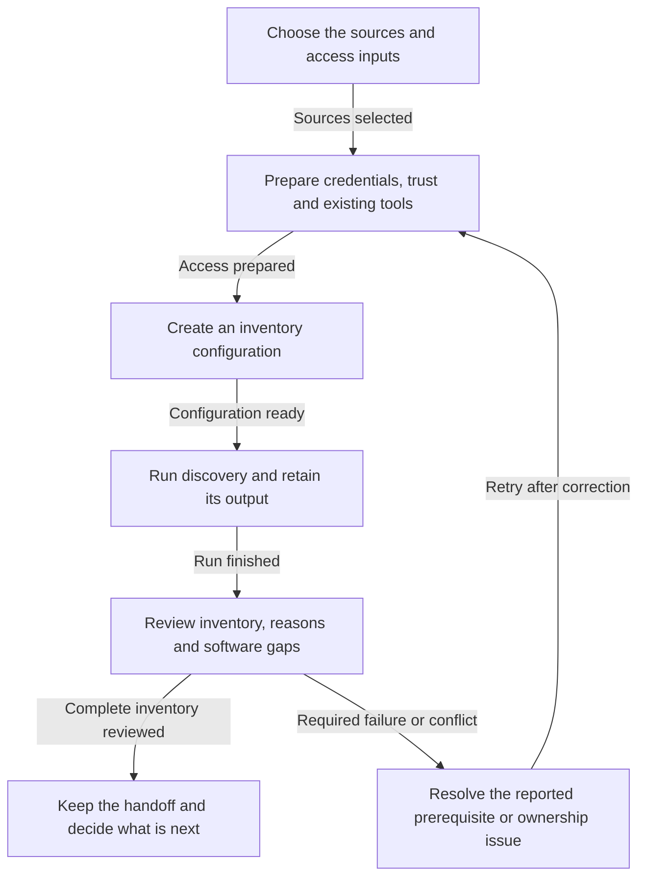
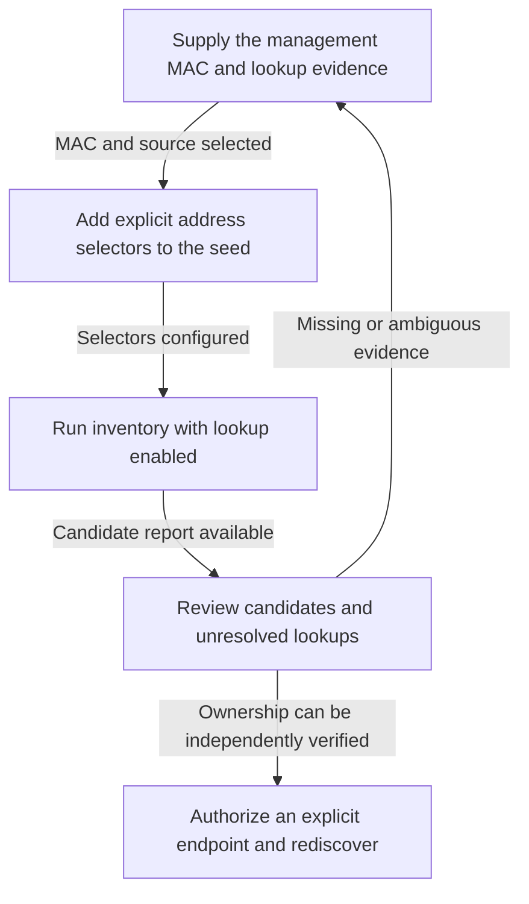
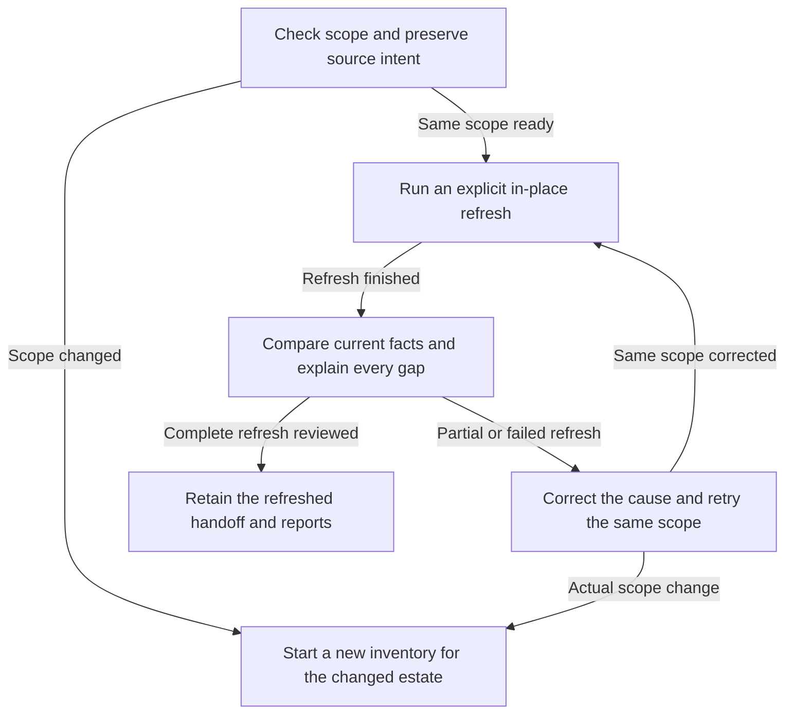

<!--
Copyright 2026 NVIDIA CORPORATION & AFFILIATES
SPDX-License-Identifier: Apache-2.0

Generated by scripts/generate-workflow-docs.py from
openspec/workflows/dpf-discovery.json. Edit the source, then regenerate.
-->

# DPF discovery workflows

Use these procedures with the experimental `l8k discover --target dpf` CLI. The DPU estate is separate from Host Network Operator deployment. Start with **inventory mode**; management probe mode is not qualified in this preview. Discovery collects facts and writes a handoff. It does not create VMs, install Kubernetes or DPF, configure DPUServices, change firmware, enroll trust, or start a DPF deployment.

For complete field and error details, see [DPF discovery reference](dpf-discovery.md). Each diagram follows the same steps as its procedure. Commands are examples to run deliberately from a machine with direct access to your selected endpoints.

## Collect the first inventory {#initial-inventory}

Use this workflow when you know the host access addresses. DPU ARM/BMC addresses are optional in inventory mode. Without explicit DPU endpoints, Launch Kit derives BlueField card records from host inventory and leaves their access bindings unknown.



### 1. Choose the sources and access inputs {#initial-inventory-choose-inputs}

Choose each source explicitly: a host operating system over SSH or its BMC over Redfish; optionally choose the DPU ARM operating system over SSH or DPU BMC over Redfish. A selected source must succeed; Launch Kit does not silently replace failed Redfish access with SSH. Host SSH can supply host-to-card identity in Zero Trust when PCI/VPD access is available. ARM SSH needs a booted, reachable DPU operating system. Neither access path proves trusted DPU state.

| Input | What you supply or allow Launch Kit to determine |
| --- | --- |
| Always required | At least one host endpoint; the source type; a credential alias, username, and password reference or SSH key reference for each selected endpoint. Addresses and credentials are not guessed. |
| Required for SSH | A verified `knownHostsFile`; direct connectivity from the CLI machine. SSH port defaults to `22`; ambient SSH config, agents and ProxyJump are not used. |
| Conditional | An explicit DPU endpoint for direct DPU measurements; a private CA for Redfish when system trust is insufficient; `systemURI` if a BMC exposes several Systems. |
| Optional | A management kubeconfig for additional observations. Inventory needs none, but an explicitly supplied kubeconfig must work. |
| Defaultable | `dpf.release` defaults to `26.4.0`; Redfish certificate verification is enabled; SSH `sudo` defaults to `false`. Choose `discovery.probes.mode: inventory` explicitly because the default management mode is unavailable in this preview. |
| Discovered | Host/system and card identities, host-to-DPU associations, visible hardware/software/network observations, and optional local BMC address hints. |

Do not provide product versions as measured facts. The embedded release BOM owns its software coordinates; live observations remain separate. Omitted or null `dpf.release` uses the pinned default; an empty or unknown release is rejected.

Next: [Sources selected](#initial-inventory-prepare).

### 2. Prepare credentials, trust and existing tools {#initial-inventory-prepare}

Put passwords in an environment variable or a private file, and SSH private keys and known-hosts entries in files under your control. Reference them from YAML; do not put password values in command-line arguments. File references are relative to that YAML file. Verify SSH keys and Redfish CA trust through your normal provisioning process.

For SSH inventory, ask the endpoint administrator to make the required read tools and permissions available before the run. Host identity/PCI collection uses tools such as `dmidecode` and `lspci`; DPU identity additionally uses `ipmitool`. Optional hardware checks use `mlxfwmanager`, `mlxconfig`, `mlxprivhost` and `systemctl`; network checks use existing `ip`, resolver and LLDP tools where available. Tool availability and access differ between host and ARM operating systems.

Set `ssh.sudo: true` only where noninteractive elevated reads are authorized and configured. Launch Kit then uses `sudo -n`; it never prompts for a sudo password, installs tools, changes privileges or repairs device settings. Missing tools, denied permissions and unsupported or malformed outputs keep specific reason codes and explanations. Required identity failures stop a complete inventory; optional unknown observations remain visible for review.

Next: [Access prepared](#initial-inventory-configure).

### 3. Create an inventory configuration {#initial-inventory-configure}

Save this example as `dpf-site.yaml`, replacing the documentation address and credential paths with your host values. It intentionally starts with host SSH only and requires no Kubernetes cluster. Ensure the listed files exist before running.

```yaml
dpf:
  release: 26.4.0
credentials:
  host-reader:
    username: inventory
    privateKeyRef: {file: ./credentials/host-key}
discovery:
  hosts:
    - credentialRef: host-reader
      ssh:
        address: 192.0.2.21:22
        knownHostsFile: ./credentials/known_hosts
        sudo: true
  probes:
    mode: inventory
```

For direct DPU ARM discovery, add a separate credential alias and a `discovery.dpus` entry with the same SSH shape. For Redfish, use `bmcEndpoint` and a password credential reference instead of `ssh`; see the [complete access examples](dpf-discovery.md#inputs-and-invocation). Each endpoint has exactly one access source. Plain YAML is the CLI input, not a Kubernetes object. Do not copy previously observed `inventory` facts into a new seed as user assertions.

Next: [Configuration ready](#initial-inventory-run).

### 4. Run discovery and retain its output {#initial-inventory-run}

Choose a new output path for the first run. Run from a machine that can reach every selected endpoint and read the referenced files.

```bash
l8k discover --target dpf --user-config dpf-site.yaml \
  --save-cluster-config dpf-discovered.yaml --output json \
  > discovery.json 2> discovery.log
```

Record the process exit status as well as the files. `discovery.json` contains the final result; progress and diagnostics go to `discovery.log`. The command creates its own run directory next to the requested YAML. It does not send credentials to addresses found during collection. Redfish uses a temporary login session and deletes that session; SSH runs read commands on explicitly selected endpoints.

Next: [Run finished](#initial-inventory-inspect).

### 5. Review inventory, reasons and software gaps {#initial-inventory-inspect}

Inspect `discovery.outcome`, `discovery.checks`, `errors`, `artifacts` and `acceptance` in the JSON report. Review saved `inventory.hosts`, `inventory.dpus`, `inventory.associations` and their evidence before using the handoff. Complete discovery writes `dpf-discovered.yaml`; partial discovery preserves an existing handoff and writes `partial.yaml` and `report.json` under `dpf-discovered.discovery/<run-id>/`. Use the report's artifact paths instead of guessing the run ID.

Read each non-success observation's `reasonCode`, `message` and `tool` where present. A missing `mlxfwmanager` is an unavailable prerequisite, not proof of an incompatible NIC firmware. A denied Redfish firmware collection is different from a component property not being exposed. Conflicting versions or ambiguous activation cannot establish a software minimum.

| Example reason | What to do |
| --- | --- |
| `TOOL_NOT_AVAILABLE` / `PERMISSION_DENIED` | Check the named endpoint tool or authorized noninteractive sudo policy; do not treat the unmeasured check as passed. |
| `ACCESS_DENIED` / `PROPERTY_NOT_EXPOSED` | Distinguish an account permission problem from a property the service does not advertise. |
| `SOFTWARE_VERSION_CONFLICT` / `SOFTWARE_IDENTITY_UNAVAILABLE` | Reconcile version/activation sources or the rejected physical identity before trusting software comparisons. |
| `SOFTWARE_BELOW_MINIMUM` | Review the release requirement and plan a separate maintenance action; discovery does not update firmware. |
| `PUBLICATION_FAILED` | Read the error explanation, resolve the local output/path problem, and rerun; only listed successfully written artifacts exist. |

The resolved software BOM is saved under `inventory.software`, including source references and unknown requirements. Release `26.4.0` has exact BlueField-3 model entries `B3210`, `B3220` and `B3240`; generic family names and BlueField-4 are not sufficient for BOM applicability. The documented NIC/MFT minima can be evaluated when current, identity-bound measurements exist. BMC, CEC, ATF, UEFI, OS/BSP and golden-image minima remain unknown where the catalog has no supported requirement. A BFB target is a desired artifact, not an observed OS/BSP version. No site-supplied minimum can turn an unknown catalog requirement into qualified support.

Exit zero and `discovery.outcome: complete` mean inventory collection, identity/mapping, cleanup and publication succeeded. `acceptance: not-evaluated` remains explicit. Profile planning, hardware qualification, DPF authentication, operator-created connectivity and deployment remain later work; DPF generate/deploy/validate are unavailable in this preview.

Next: [Complete inventory reviewed](#initial-inventory-finish); [Required failure or conflict](#initial-inventory-resolve).

### 6. Resolve the reported prerequisite or ownership issue {#initial-inventory-resolve}

Use the specific recorded reason to correct the source configuration or ask the infrastructure owner to repair missing tools, permissions, credentials, connectivity or conflicting identity. Do not delete unknown observations or label them passed. Optional gaps may remain documented without blocking inventory; required source failures, identity ambiguity, cleanup or publication errors need resolution. If cleanup is uncertain, use the reported session/resource ownership evidence before any manual action. Rerun after correcting the cause.

Next: [Retry after correction](#initial-inventory-prepare).

### 7. Keep the handoff and decide what is next {#initial-inventory-finish}

Retain the seed, discovered YAML, JSON report and stderr log together. The discovered YAML preserves configuration intent and replaces observed inventory; it is not a deployment-ready profile or a provisioning approval. If a DPU access address is missing, use [address-candidate lookup](#address-candidates). For later remeasurement of the same estate, use [refresh](#refresh-inventory).

## Find and verify address candidates {#address-candidates}

Use this optional inventory addition when you know an ARM or BMC management MAC but need its possible IP address. It is a locator workflow, not authentication or identity discovery. You still need the host configuration from the first workflow; this is not a standalone subnet scanner.



### 1. Supply the management MAC and lookup evidence {#address-candidates-locators}

Obtain the exact ARM or BMC management MAC from authoritative asset records or a trustworthy observed interface. You must choose its role (`arm` or `bmc`) and a unique name. Launch Kit does not infer a management MAC from a NIC serial, data-port MAC, hostname or neighboring address.

Optionally obtain a current dnsmasq IPv4 lease-file snapshot through your authorized DHCP administration process and place it on the CLI machine. Launch Kit reads this file locally; it does not log in to a DHCP server or query arbitrary vendor lease APIs. With no lease files, it can use suitable neighbors observed on the SSH endpoints already selected for inventory. Only `REACHABLE` or `PERMANENT` neighbors are candidates; stale entries are excluded.

Next: [MAC and source selected](#address-candidates-configure).

### 2. Add explicit address selectors to the seed {#address-candidates-configure}

Merge this fragment into the existing `discovery` section of a seed without saved inventory. Replace the MACs and file path; omit `sources` if you only want eligible observed neighbors. Do not replace the required host list.

```yaml
discovery:
  addressLookup:
    sources:
      - file: ./inputs/dnsmasq.leases
        format: dnsmasq-leases
    devices:
      - name: dpu-a-arm
        role: arm
        mac: '02:00:00:00:00:11'
      - name: dpu-a-bmc
        role: bmc
        mac: '02:00:00:00:00:12'
```

The supported file contains the five dnsmasq IPv4 columns: expiry epoch, MAC, IP, hostname and client ID. An expiry of `0` means a nonexpiring record; expired records are not candidates. Each file must be readable, at most 1 MiB and at most 4096 records. A malformed file contributes no candidates and retains a source failure reason. Other DHCP formats are unsupported.

Next: [Selectors configured](#address-candidates-run).

### 3. Run inventory with lookup enabled {#address-candidates-run}

Save the configured seed as `dpf-lookup.yaml` and select a new handoff path.

```bash
l8k discover --target dpf --user-config dpf-lookup.yaml \
  --save-cluster-config dpf-candidates.yaml --output json \
  > candidates.json 2> candidates.log
```

Lookup happens as part of this inventory run. It reads only the configured lease files and already observed SSH neighbors. No candidate is contacted and no credential is sent to it.

Next: [Candidate report available](#address-candidates-review).

### 4. Review candidates and unresolved lookups {#address-candidates-review}

Read `inventory.addressLookup.candidates` for the address, selected name/role/MAC, source and evidence reference. Read `inventory.addressLookup.observations` for each device and lease source. A single address is `ADDRESS_UNVERIFIED`; several addresses for a MAC remain ambiguous, and missing/expired/unreadable evidence keeps its reason. A candidate is not a host-to-DPU association and is never a readiness pass.

Use your DHCP/network or asset owner to resolve multiple, missing or contradictory locators. Do not choose an address merely because it is the first result. Independent identity and endpoint trust are still required even for one candidate.

Next: [Ownership can be independently verified](#address-candidates-bind); [Missing or ambiguous evidence](#address-candidates-locators).

### 5. Authorize an explicit endpoint and rediscover {#address-candidates-bind}

Verify endpoint ownership and obtain SSH known-hosts trust or Redfish CA trust and the appropriate account through your normal process. Create a new seed and add the verified endpoint under `discovery.dpus`, with its credential reference and trust policy. Use a new output when changing scope; do not edit the old observed identity to force a match.

Run [initial inventory](#initial-inventory) for that explicit endpoint. Only its authenticated physical-card observation and unique host-card association can establish the binding. A discovered IP alone never authorizes Redfish access or proves Zero Trust attestation.

## Refresh an existing inventory {#refresh-inventory}

Use this workflow to remeasure the same selected estate, compare facts and preserve diagnostic history. A refresh is another live read; old successful observations do not stand in for unavailable current measurements.



### 1. Check scope and preserve source intent {#refresh-inventory-scope}

Start from the existing discovered YAML and keep its credential/trust references valid. Decide whether you are remeasuring the same host/DPU endpoints and trust policy. If endpoint selection, trust policy or physical identity has changed, create a fresh seed without old `inventory` and use a new output path. Investigate unexpected replacement or ownership changes before accepting them.

Do not manually edit observed serials, associations, firmware or check outcomes. `dpf.release` selects the embedded BOM; changing the release does not upgrade software. An omitted release continues to resolve to the CLI's pinned default, so record the CLI version and review `inventory.software` when comparing runs from different binaries. Explicit release selection makes that intention visible.

Next: [Same scope ready](#refresh-inventory-run); [Scope changed](#refresh-inventory-new-scope).

### 2. Run an explicit in-place refresh {#refresh-inventory-run}

Use the same YAML path for input and output and explicitly supply `--save-cluster-config`:

```bash
l8k discover --target dpf --user-config dpf-discovered.yaml \
  --save-cluster-config dpf-discovered.yaml --output json \
  > refresh.json 2> refresh.log
```

The run retains `source-before.yaml`. Complete discovery replaces inventory while preserving user sections, comments and input intent. Relative file references are rebased if saving elsewhere; private files are not copied. Avoid simultaneous external edits, and use real output directories rather than symlink aliases. Credentials, trust files and configured lease files cannot be used as output destinations.

Next: [Refresh finished](#refresh-inventory-compare).

### 3. Compare current facts and explain every gap {#refresh-inventory-compare}

Review `diff`, current checks, `errors`, cleanup and successfully written `artifacts` in the result. Compare physical identity, firmware, relevant hardware/mode/network observations and resolved release requirements. A failed current observation stays unknown rather than inheriting an earlier pass; semantic list ordering alone should not produce a changed fact.

On partial collection, the previous handoff remains intact and the new partial YAML/report live under `dpf-discovered.discovery/<run-id>/`. Inspect the new report instead of mistaking the unchanged handoff for fresh success. Required failures need correction and another run. Optional missing tools or inaccessible properties remain explained observations; they do not make deployment readiness pass.

Next: [Complete refresh reviewed](#refresh-inventory-retain); [Partial or failed refresh](#refresh-inventory-repair).

### 4. Correct the cause and retry the same scope {#refresh-inventory-repair}

Use the saved reason and affected source to repair the external prerequisite or fix the input. Preserve the unsuccessful run's report. Do not overwrite failure evidence with an old successful observation. If the cause is a real endpoint, trust or identity change, switch to a fresh seed and output.

Next: [Same scope corrected](#refresh-inventory-run); [Actual scope change](#refresh-inventory-new-scope).

### 5. Start a new inventory for the changed estate {#refresh-inventory-new-scope}

Create a new seed from the desired access configuration, without copying old `inventory` facts, and select a new handoff path. Recheck endpoint ownership/trust and follow [initial inventory](#initial-inventory). Keep the previous estate's handoff and report as history.

### 6. Retain the refreshed handoff and reports {#refresh-inventory-retain}

Keep `source-before.yaml`, the current YAML, JSON/stdout report and stderr log. Discovery completion still means a successful inventory workflow, with deployment `acceptance: not-evaluated`. Unknown BOM constraints, hardware qualification and operator-created service checks remain visible until their later workflows are implemented and verified.
