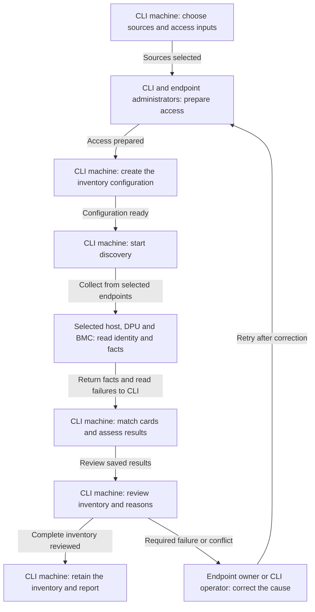
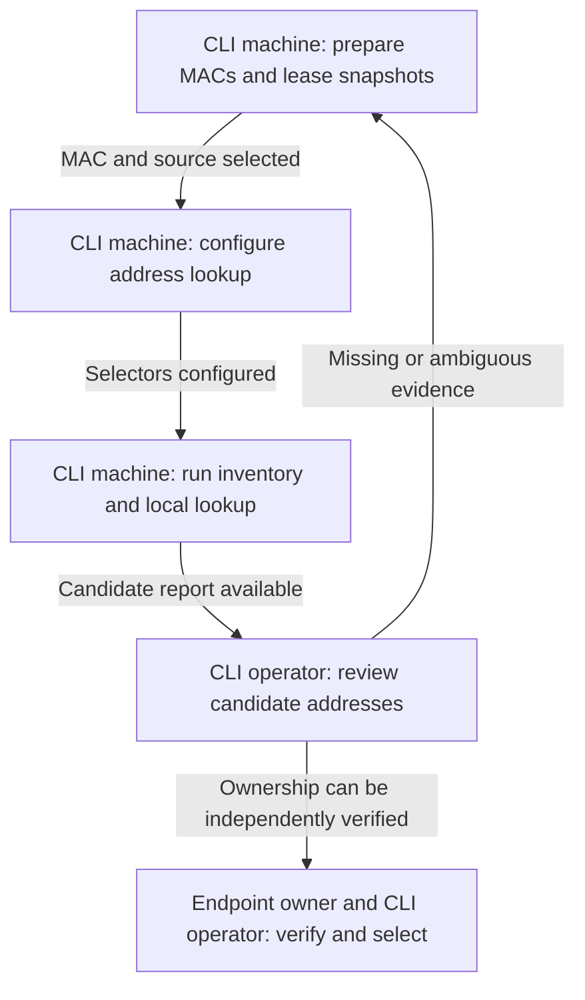
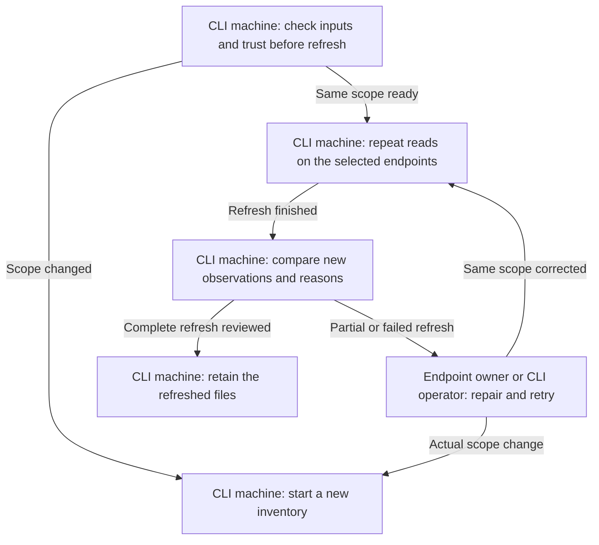

<!--
Copyright 2026 NVIDIA CORPORATION & AFFILIATES
SPDX-License-Identifier: Apache-2.0

Generated by scripts/generate-workflow-docs.py from
openspec/workflows/dpf-discovery.json. Edit the source, then regenerate.
-->

# DPF discovery workflows

Use these procedures with the experimental `l8k discover --target dpf` CLI. The DPU estate is separate from Host Network Operator deployment. Start with **inventory mode**; management probe mode is unavailable in this preview. Discovery collects facts and writes a handoff. It does not create VMs, install Kubernetes or DPF, configure DPUServices, change firmware, enroll trust, or start a DPF deployment.

For complete field and error details, see [DPF discovery reference](dpf-discovery.md). Each diagram follows the same steps as its procedure. Commands are examples to run deliberately from a machine with direct access to your selected endpoints.

## Collect the first inventory {#initial-inventory}

Use this workflow when you know the host access addresses. Explicit DPU BMC endpoints and verified administrator privileges are required for a complete inventory. Without explicit DPU endpoints, Launch Kit derives BlueField card records from host inventory and leaves their access bindings unknown; host-only or ARM-only discovery retains partial evidence and exits nonzero.



### 1. CLI machine: choose sources and access inputs {#initial-inventory-choose-inputs}

Choose each source explicitly: a host operating system over SSH or its BMC over Redfish; choose the DPU BMC over Redfish for a complete run. DPU ARM SSH is available for partial evidence but cannot verify BMC administrator privileges. A selected source must succeed; Launch Kit does not silently replace failed Redfish access with SSH. Host SSH can supply host-to-card identity in Zero Trust when PCI/VPD access is available. ARM SSH needs a booted, reachable DPU operating system. Neither access path proves trusted DPU state.

| Input | What you supply or allow Launch Kit to determine |
| --- | --- |
| Always required | At least one host endpoint and explicit DPU BMC endpoints with administrator credentials for completion; the source type; a credential alias, username, and password reference or SSH key reference for each selected endpoint. Addresses and credentials are not guessed. |
| Required for SSH | A verified `knownHostsFile`; direct connectivity from the CLI machine. SSH port defaults to `22`; ambient SSH config, agents and ProxyJump are not used. |
| Conditional | DPU ARM SSH for partial OS measurements; a private CA for Redfish when system trust is insufficient; `systemURI` if a BMC exposes several Systems. |
| Optional | A management kubeconfig for additional observations. Inventory needs none, but an explicitly supplied kubeconfig must work. |
| Defaultable | `dpf.release` defaults to `26.4.0`; Redfish certificate verification is enabled; SSH `sudo` defaults to `false`. Choose `discovery.probes.mode: inventory` explicitly because the default management mode is unavailable in this preview. |
| Discovered | Host/system and card identities, host-to-DPU associations, visible hardware/software/network observations, and optional local BMC address hints. |

Use an account whose own session proves its effective administrator role. If session Roles is absent, local authentication must be established by an explicit trusted local session `UserAuthenticationSource`. A current `LocalAccountAuth: Enabled` policy alone cannot prove how an existing session authenticated. Disabled local authentication and explicitly external session sources are unsupported; Fallback/LocalFirst require the explicit local session source. Missing origin plus missing Roles cannot inherit privileges from a same-named local administrator. Discovery reports unverifiable proof as partial without replacing a complete handoff.

Do not provide product versions as measured facts. The selected release supplies the software bill of materials (BOM); discovery measures installed versions separately. Omitted or null `dpf.release` uses the pinned default; an empty or unknown release is rejected.

All network connections start from the machine where you run `l8k`. Host and DPU endpoints do not need to connect to each other for this workflow.

| Connection from the CLI machine | Where the operation runs | What it provides |
| --- | --- | --- |
| SSH to the selected host | Host operating system | Host identity, installed card serials and available host/card facts |
| SSH to the selected DPU ARM address | DPU operating system | DPU identity, local hardware/network facts, and optionally its BMC address through local IPMI |
| HTTPS to a selected host or DPU BMC | That BMC's Redfish service | System/card identity and available firmware, clock and NTP information |
| HTTPS to the management API, only if a kubeconfig is supplied | Existing management Kubernetes API | Cluster identity, version and nodes, plus optional storage and advertised DPF API information |
| No remote connection | CLI machine | Read input/trust/lease files, match identities, compare software requirements and save results |

Choose SSH or Redfish separately for each endpoint. Selecting host Redfish does not run tools in the host OS. Selecting DPU SSH does not log in to DPU Redfish. The [collection step](#initial-inventory-collect) lists the operations for each choice.

Next: [Sources selected](#initial-inventory-prepare).

### 2. CLI and endpoint administrators: prepare access {#initial-inventory-prepare}

Put passwords in an environment variable or a private file, and SSH private keys and known-hosts entries in files under your control. Reference them from YAML; do not put password values in command-line arguments. File references are relative to that YAML file. Verify SSH keys and Redfish CA trust through your normal provisioning process.

For SSH inventory, ask the endpoint administrator to make the required read tools and permissions available before the run. Host identity/PCI collection uses tools such as `dmidecode` and `lspci`; DPU identity additionally uses `ipmitool`. Optional hardware checks use `mlxfwmanager`, `mlxconfig`, `mlxprivhost` and `systemctl`; network checks use existing `ip`, resolver and LLDP tools where available. Tool availability and access differ between host and ARM operating systems.

Set `ssh.sudo: true` only where noninteractive elevated reads are authorized and configured. Launch Kit then uses `sudo -n`; it never prompts for a sudo password, installs tools, changes privileges or repairs device settings. Missing tools, denied permissions and unsupported or malformed outputs keep specific reason codes and explanations. Required identity failures stop a complete inventory; optional unknown observations remain visible for review.

Prepare a DPU BMC account that is enabled, unlocked and does not require a password change, with all five standard Administrator privileges. A custom role with those privileges is accepted; names alone are insufficient. Discovery verifies the session, unique matching account and linked role using read requests. Handle password changes separately before rerunning; discovery never rotates passwords or tests privileges through writes.

Next: [Access prepared](#initial-inventory-configure).

### 3. CLI machine: create the inventory configuration {#initial-inventory-configure}

Save this example as `dpf-site.yaml`, replacing the documentation address and credential paths with your host values. It uses host SSH and DPU BMC Redfish and requires no Kubernetes cluster. Ensure the listed files exist before running.

```yaml
dpf:
  release: 26.4.0
credentials:
  host-reader:
    username: inventory
    privateKeyRef: {file: ./credentials/host-key}
  dpu-maintainer:
    username: bmc-maintainer
    passwordRef: {env: DPU_BMC_PASSWORD}
discovery:
  hosts:
    - credentialRef: host-reader
      ssh:
        address: 192.0.2.21:22
        knownHostsFile: ./credentials/known_hosts
        sudo: true
  dpus:
    - bmcEndpoint: https://192.0.2.11
      credentialRef: dpu-maintainer
  probes:
    mode: inventory
```

For DPU ARM observations, use the SSH shape instead; ARM-only DPU input produces partial inventory with a nonzero exit because it cannot prove BMC administrator privileges. For Redfish, use `bmcEndpoint` and a password credential reference instead of `ssh`; see the [complete access examples](dpf-discovery.md#inputs-and-invocation). Each endpoint has exactly one access source. Plain YAML is the CLI input, not a Kubernetes object. Do not copy previously observed `inventory` facts into a new seed as user assertions.

Next: [Configuration ready](#initial-inventory-run).

### 4. CLI machine: start discovery {#initial-inventory-run}

Choose a new output path for the first run. Run from a machine that can reach every selected endpoint and read the referenced files.

```bash
l8k discover --target dpf --user-config dpf-site.yaml \
  --save-cluster-config dpf-discovered.yaml --output json \
  > discovery.json 2> discovery.log
```

Record the process exit status as well as the files. `discovery.json` contains the final result; progress and diagnostics go to `discovery.log`. The command creates its own run directory next to the requested YAML. It does not send credentials to addresses found during collection. Redfish uses a temporary login session and deletes that session; SSH runs read commands on explicitly selected endpoints.

While this command runs, Launch Kit performs the collection and matching steps below automatically. You do not need to run the listed remote commands yourself. The example contacts the host over SSH and the explicitly selected DPU BMC over Redfish. Host-only input contacts no DPU endpoint and returns partial evidence with a nonzero exit.

Next: [Collect from selected endpoints](#initial-inventory-collect).

### 5. Selected host, DPU and BMC: read identity and facts {#initial-inventory-collect}

Launch Kit uses the configured connection for each endpoint. Required identity reads and DPU BMC administrator verification must succeed to complete inventory. Optional reads add facts; a missing tool, denied operation or unsupported response leaves an explained gap instead of silently passing the check. After collecting optional facts, Launch Kit rereads identity to detect a changed or replaced device.

**On a host selected through SSH**

| Read performed on the host | Purpose and result | Required or optional |
| --- | --- | --- |
| `dmidecode -s system-uuid` | Identifies the physical host. | Required |
| `lspci -Dnn -d 15b3:` and per-card `lspci -D -vv -s <PCI-address>` | Finds NVIDIA network cards, their PCI locations and available card serial/slot information. | PCI enumeration is required; a selected DPU needs a usable serial for host-to-card matching. Missing serials remain visible. |
| Linux PCI device files | Reads each function's network interface, driver and NUMA location. | Optional |
| `systemctl show rshim --property=LoadState --property=ActiveState` | Reports whether the host's RShim service is present and active. It does not start the service or use it to access a DPU. | Optional |

**On a DPU ARM operating system selected through SSH**

| Read performed on the DPU ARM OS | Purpose and result | Required or optional |
| --- | --- | --- |
| `dmidecode -s system-serial-number` and `ipmitool fru print 0` | Reads system and built-in card records; their serials must agree. Also records available model/board information. | Required for DPU identity |
| `ipmitool lan print` | Reads the local BMC's configured LAN address over local IPMI. | Optional |
| `lspci -Dnn -d 15b3:` and per-card `lspci -D -vv -s <PCI-address>` | Locates ARM-visible NVIDIA cards and available card serials before associating hardware readings with them. | Optional |
| `mlxprivhost -d <PCI-address> q --full` | Reports host privilege restrictions, such as restricted access or disabled RShim, for a visible BlueField. | Optional |

Local IPMI is an operation **from the DPU ARM OS to its local BMC**, not an HTTPS login from the CLI. The returned BMC address is recorded, but Launch Kit does not connect to it or send it credentials. Host and ARM PCI addresses are local to different operating systems and need not match.

**On each selected host or DPU ARM OS, through SSH**

| Read performed on that OS | Purpose and result |
| --- | --- |
| `mlxfwmanager --version` | Records the installed MFT tool version. |
| `mlxfwmanager --query -d <PCI-address>` | Queries the specific visible card's current NIC firmware and PSID. |
| `mlxconfig -d <PCI-address> q <parameter>` | Reads `INTERNAL_CPU_OFFLOAD_ENGINE`, `INTERNAL_CPU_RSHIM` and `NUM_OF_VFS` on visible BlueFields. These results are next-boot settings, not proof of the running mode. |
| `hostname`, `cat /etc/os-release`, `ip -j address show`, `ip -j -4 route show` | Reports the OS, local addresses and IPv4 routes. |
| `ip -j link show`, `ip -j -d link show`, `ip -j neighbor show` | Reports MACs, bridge/member relationships, available link details and neighbors already known to that OS. It does not scan the subnet. |
| `cat /etc/resolv.conf`, `readlink -f /etc/resolv.conf`, `resolvectl dns`, `resolvectl domain` | Reports configured DNS servers, search domains, per-link DNS and the resolver configuration in use. |
| Selected `server=` and `no-resolv` settings in `/etc/dnsmasq.conf` and `/etc/dnsmasq.d/*.conf` | Reports local dnsmasq DNS forwarding configuration. This is separate from reading a DHCP lease snapshot on the CLI machine. |
| `lldpctl -f keyvalue` | Reports neighbors already available from the local LLDP service. |

These hardware and network reads are optional. `<PCI-address>` comes from that same OS's card inventory; Launch Kit queries each card separately. In Zero Trust, the host may be unable to query a restricted card even when `mlxfwmanager` is installed. That limitation is reported; it does not cause an automatic connection to the DPU. Tools must be installed on the OS where the command runs, not merely on the CLI machine. When configured, protected hardware reads use `sudo -n`; tools are never installed or settings changed by discovery.

**On a selected host or DPU BMC, through HTTPS Redfish**

The CLI creates a temporary session, reads system and card inventory, and queries available firmware components, BMC time and NTP configuration. Host BMC reads locate cards associated with the selected host; DPU BMC reads identify that DPU and verify the authenticated session account and linked role through AccountService. All five standard Administrator privileges and enabled/unlocked/no-password-change state are required; denied or unverifiable evidence fails closed. The supported BF4/B4240 reader also records an optional PSID from the selected System or identity-selected chassis AssetTag, with source evidence and a final reread. Missing PSID stays unknown; invalid, contradictory or changed fields remain unavailable for consumers requiring PSID. No PSID is guessed from the model. No SSH commands run in either OS for this choice. System/card identity is required; optional firmware or clock properties may remain unknown. A firmware version is not assumed to be running unless the BMC explicitly identifies it as active. The CLI deletes its session afterward and reports any cleanup failure. It does not change passwords, roles, firmware, NTP, power or trust settings.

**At the management Kubernetes API, if configured**

The CLI reads the cluster identity from `kube-system`, the Kubernetes version and the node list, including control-plane membership and reported readiness. These reads are required when you supply a management kubeconfig. StorageClasses and advertised DPF API groups are additional optional reads. Inventory mode creates no Pods and performs no management-network connectivity tests. It does not install DPF or run commands inside Kubernetes nodes.

Next: [Return facts and read failures to CLI](#initial-inventory-match).

### 6. CLI machine: match cards and assess results {#initial-inventory-match}

Launch Kit compares physical card serials returned by the selected sources. Each explicit DPU must match exactly one adapter on one observed host. A missing serial, conflicting identity or multiple matches prevents a complete inventory; an IP address or PCI address cannot substitute for that match. With host-only input, the inventory lists host-reported BlueFields without claiming a working ARM or BMC connection. These records remain partial and fail the required DPU BMC administrator check; ARM SSH cannot bypass that requirement.

Next, the CLI compares eligible measured versions with the selected release's documented requirements. It reports unavailable measurements and unknown requirements separately from below-minimum versions. These comparisons do not install or update software.

If address lookup is configured, the CLI separately matches your supplied management MACs to local lease-file records and neighbors read from the selected SSH endpoints. These are unverified IP candidates, not card identities or host-to-DPU associations. No candidate is contacted automatically.

Finally, the CLI checks collection and session-cleanup results, compares against any previous inventory, and writes the YAML and report. Required failures produce partial output; optional gaps remain recorded even when inventory completes. All output files are written on the CLI machine.

Next: [Review saved results](#initial-inventory-inspect).

### 7. CLI machine: review inventory and reasons {#initial-inventory-inspect}

Inspect `discovery.outcome`, `discovery.checks`, `errors`, `artifacts` and `acceptance` in the JSON report. Review saved `inventory.hosts`, `inventory.dpus`, `inventory.associations` and their evidence before using the handoff. Complete discovery writes `dpf-discovered.yaml`; partial discovery preserves an existing handoff and writes `partial.yaml` and `report.json` under `dpf-discovered.discovery/<run-id>/`. Use the report's artifact paths instead of guessing the run ID.

Read each non-success observation's `reasonCode`, `message` and `tool` where present. A missing `mlxfwmanager` is an unavailable prerequisite, not proof of an incompatible NIC firmware. A denied Redfish firmware collection is different from a component property not being exposed. Conflicting versions or ambiguous activation cannot establish a software minimum.

| Example reason | What to do |
| --- | --- |
| `TOOL_NOT_AVAILABLE` / `PERMISSION_DENIED` | Check the named endpoint tool or authorized noninteractive sudo policy; do not treat the unmeasured check as passed. |
| `ACCESS_DENIED` / `PROPERTY_NOT_EXPOSED` | Distinguish an account permission problem from a property the service does not advertise. |
| `SOFTWARE_VERSION_CONFLICT` / `SOFTWARE_IDENTITY_UNAVAILABLE` | Reconcile version/activation sources or the rejected physical identity before trusting software comparisons. |
| `SOFTWARE_BELOW_MINIMUM` | Review the release requirement and plan a separate maintenance action; discovery does not update firmware. |
| `HOST_ADAPTER_VENDOR_CONFLICT` | Inspect the selected endpoints and matching serial/PCI evidence: a same-serial host adapter reports a non-NVIDIA vendor. Correct the source and rediscover; do not edit observed identity or discard a contradictory candidate to force a match. |
| `BMC_ADMIN_REQUIRED` / `BMC_ADMIN_ACCESS_DENIED` | Use an authorized account with all standard Administrator privileges and readable account/role evidence. |
| `BMC_ADMIN_UNVERIFIABLE` / `BMC_ADMIN_NOT_VERIFIED` | Supply explicit trusted DPU BMC access and inspect session Roles, authentication origin and linked account/role evidence. Host/ARM SSH and a same-named local administrator cannot substitute for verified session privileges. |
| `BMC_PASSWORD_CHANGE_REQUIRED` / `BMC_ADMIN_ACCOUNT_RESTRICTED` | Ask the administrator to resolve password-change, disabled or locked state separately, then rerun. Discovery does not repair access. |
| `PUBLICATION_FAILED` | Read the error explanation, resolve the local output/path problem, and rerun; only listed successfully written artifacts exist. |

The resolved software BOM is saved under `inventory.software`, including source references and unknown requirements. Release `26.4.0` has exact BlueField-3 model entries `B3210`, `B3220` and `B3240`; generic family names and BlueField-4 are not sufficient for BOM applicability. The documented NIC/MFT minima can be evaluated when current measurements associated with the correct device exist. BMC, CEC, ATF, UEFI, OS/BSP and golden-image minima remain unknown where the catalog has no supported requirement. A BFB target is a desired artifact, not an observed OS/BSP version. An unknown requirement must remain unresolved; supplying a guessed minimum does not establish compatibility.

Exit zero and `discovery.outcome: complete` mean inventory collection, identity/mapping, cleanup and publication succeeded. `acceptance: not-evaluated` remains explicit. Hardware support, DPF authentication, service connectivity and deployment still need separate assessment; DPF generate/deploy/validate are unavailable in this preview.

Next: [Complete inventory reviewed](#initial-inventory-finish); [Required failure or conflict](#initial-inventory-resolve).

### 8. Endpoint owner or CLI operator: correct the cause {#initial-inventory-resolve}

Use the specific recorded reason to correct the source configuration or ask the infrastructure owner to repair missing tools, permissions, credentials, connectivity or conflicting identity. Do not delete unknown observations or label them passed. Optional gaps may remain documented without blocking inventory; required source failures, identity ambiguity, cleanup or publication errors need resolution. If cleanup is uncertain, use the reported session/resource ownership evidence before any manual action. Rerun after correcting the cause.

Next: [Retry after correction](#initial-inventory-prepare).

### 9. CLI machine: retain the inventory and report {#initial-inventory-finish}

Retain the seed, discovered YAML, JSON report and stderr log together. The discovered YAML preserves configuration intent and replaces observed inventory; it is not a deployment-ready profile or a provisioning approval. If a DPU access address is missing, use [address-candidate lookup](#address-candidates). For later remeasurement of the same estate, use [refresh](#refresh-inventory).

## Find and verify address candidates {#address-candidates}

Use this optional inventory addition when you know an ARM or BMC management MAC but need its possible IP address. It is a locator workflow, not authentication or identity discovery. You still need the host configuration from the first workflow; this is not a standalone subnet scanner.



### 1. CLI machine: prepare MACs and lease snapshots {#address-candidates-locators}

Obtain the exact ARM or BMC management MAC from authoritative asset records or a trustworthy observed interface. You must choose its role (`arm` or `bmc`) and a unique name. Launch Kit does not infer a management MAC from a NIC serial, data-port MAC, hostname or neighboring address.

Optionally obtain a current dnsmasq IPv4 lease-file snapshot through your authorized DHCP administration process and place it on the CLI machine. Launch Kit reads this file locally; it does not log in to a DHCP server or query arbitrary vendor lease APIs. With no lease files, it can use suitable neighbors observed on the SSH endpoints already selected for inventory. Only `REACHABLE` or `PERMANENT` neighbors are candidates; stale entries are excluded.

Next: [MAC and source selected](#address-candidates-configure).

### 2. CLI machine: configure address lookup {#address-candidates-configure}

Merge this fragment into the existing `discovery` section of a seed without saved inventory. Replace the MACs and file path; omit `sources` if you only want eligible observed neighbors. Do not replace the required host list.

```yaml
discovery:
  addressLookup:
    sources:
      - file: ./inputs/dnsmasq.leases
        format: dnsmasq-leases
    devices:
      - name: dpu-a-arm
        role: arm
        mac: '02:00:00:00:00:11'
      - name: dpu-a-bmc
        role: bmc
        mac: '02:00:00:00:00:12'
```

The supported file contains the five dnsmasq IPv4 columns: expiry epoch, MAC, IP, hostname and client ID. An expiry of `0` means a nonexpiring record; expired records are not candidates. Each file must be readable, at most 1 MiB and at most 4096 records. A malformed file contributes no candidates and retains a source failure reason. Other DHCP formats are unsupported.

Next: [Selectors configured](#address-candidates-run).

### 3. CLI machine: run inventory and local lookup {#address-candidates-run}

Save the configured seed as `dpf-lookup.yaml` and select a new handoff path.

```bash
l8k discover --target dpf --user-config dpf-lookup.yaml \
  --save-cluster-config dpf-candidates.yaml --output json \
  > candidates.json 2> candidates.log
```

The selected endpoints undergo the same [identity and optional reads](#initial-inventory-collect) as first inventory. On the CLI machine, address lookup then reads the configured lease snapshots and matches the supplied MACs against those records and the neighbors returned by remote `ip -j neighbor show`. No candidate is contacted and no credential is sent to it.

Next: [Candidate report available](#address-candidates-review).

### 4. CLI operator: review candidate addresses {#address-candidates-review}

Read `inventory.addressLookup.candidates` for the address, selected name/role/MAC, source and evidence reference. Read `inventory.addressLookup.observations` for each device and lease source. A single address is `ADDRESS_UNVERIFIED`; several addresses for a MAC remain ambiguous, and missing/expired/unreadable evidence keeps its reason. A candidate is not a host-to-DPU association and is never a readiness pass.

Use your DHCP/network or asset owner to resolve multiple, missing or contradictory locators. Do not choose an address merely because it is the first result. Independent identity and endpoint trust are still required even for one candidate.

Next: [Ownership can be independently verified](#address-candidates-bind); [Missing or ambiguous evidence](#address-candidates-locators).

### 5. Endpoint owner and CLI operator: verify and select {#address-candidates-bind}

Verify endpoint ownership and obtain SSH known-hosts trust or Redfish CA trust and the appropriate account through your normal process. Create a new seed and add the verified endpoint under `discovery.dpus`, with its credential reference and trust policy. Use a new output when changing scope; do not edit the old observed identity to force a match.

Run [initial inventory](#initial-inventory) for that explicit endpoint. Only its authenticated physical-card observation and unique host-card association can establish the binding. A discovered IP alone never authorizes Redfish access or proves Zero Trust attestation.

## Refresh an existing inventory {#refresh-inventory}

Use this workflow to remeasure the same selected estate, compare facts and preserve diagnostic history. A refresh is another live read; old successful observations do not stand in for unavailable current measurements.



### 1. CLI machine: check inputs and trust before refresh {#refresh-inventory-scope}

Start from the existing discovered YAML and keep its credential/trust references valid. Decide whether you are remeasuring the same host/DPU endpoints and trust policy. If endpoint selection, trust policy or physical identity has changed, create a fresh input without old `inventory` and use a new output path. Investigate unexpected replacement or ownership changes before accepting them.

Changing Redfish certificate verification or the contents of a custom CA file requires a new inventory. Moving an unchanged CA file to another path does not. Keep the CLI machine's operating-system trust store maintained; discovery does not report changes within that store.

Some inventories saved by older preview versions cannot be refreshed. If the command reports that the old inventory is incompatible, verify endpoint ownership, create a fresh input without saved `inventory`, and use a new output path. Keep the previous file as history; do not edit its recorded identities or trust information to bypass the error.

Do not manually edit observed serials, associations, firmware or check outcomes. `dpf.release` selects the release's BOM; changing it does not upgrade software. An omitted release uses the CLI's default, so record the CLI version and review `inventory.software` when comparing runs from different versions. Specify the release explicitly when you want to retain that choice.

Next: [Same scope ready](#refresh-inventory-run); [Scope changed](#refresh-inventory-new-scope).

### 2. CLI machine: repeat reads on the selected endpoints {#refresh-inventory-run}

Launch Kit repeats the [same reads on the selected host, DPU, BMC and optional management API](#initial-inventory-collect), then matches the returned identities and compares them with the saved inventory. Run from the CLI machine using the same YAML path for input and output and explicitly supply `--save-cluster-config`:

```bash
l8k discover --target dpf --user-config dpf-discovered.yaml \
  --save-cluster-config dpf-discovered.yaml --output json \
  > refresh.json 2> refresh.log
```

A complete in-place refresh retains `source-before.yaml` before replacing inventory while preserving user sections, comments and input intent. A partial run leaves the original input unchanged and writes its new observations separately; it does not create this backup. Relative file references are rebased if saving elsewhere; private files are not copied. Avoid simultaneous external edits, and use real output directories rather than symlink aliases. Credentials, trust files and configured lease files cannot be used as output destinations.

Next: [Refresh finished](#refresh-inventory-compare).

### 3. CLI machine: compare new observations and reasons {#refresh-inventory-compare}

Review `diff`, current checks, `errors`, cleanup and successfully written `artifacts` in the result. Compare physical identity, firmware, relevant hardware/mode/network observations and resolved release requirements. A failed current observation stays unknown rather than inheriting an earlier pass. Reordered lists alone are not changes to the observed configuration.

On partial collection, the previous handoff remains intact and the new partial YAML/report live under `dpf-discovered.discovery/<run-id>/`. Inspect the new report instead of mistaking the unchanged handoff for fresh success. Required failures need correction and another run. Optional missing tools or inaccessible properties remain explained observations; they do not make deployment readiness pass.

Next: [Complete refresh reviewed](#refresh-inventory-retain); [Partial or failed refresh](#refresh-inventory-repair).

### 4. Endpoint owner or CLI operator: repair and retry {#refresh-inventory-repair}

Use the saved reason and affected source to repair the external prerequisite or fix the input. Preserve the unsuccessful run's report. Do not overwrite failure evidence with an old successful observation. If the cause is a real endpoint, trust or identity change, switch to a fresh seed and output.

Next: [Same scope corrected](#refresh-inventory-run); [Actual scope change](#refresh-inventory-new-scope).

### 5. CLI machine: start a new inventory {#refresh-inventory-new-scope}

Create a new seed from the desired access configuration, without copying old `inventory` facts, and select a new handoff path. Recheck endpoint ownership/trust and follow [initial inventory](#initial-inventory). Keep the previous estate's handoff and report as history.

### 6. CLI machine: retain the refreshed files {#refresh-inventory-retain}

Keep the current YAML, JSON/stdout report and stderr log, plus `source-before.yaml` when a complete in-place refresh created it. Discovery completion still means a successful inventory workflow, with deployment `acceptance: not-evaluated`. Unknown software requirements and unverified deployment prerequisites remain unresolved; a refreshed inventory does not enable DPF deployment.
