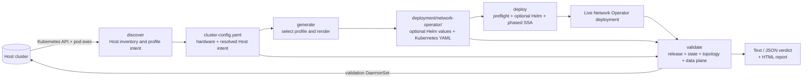
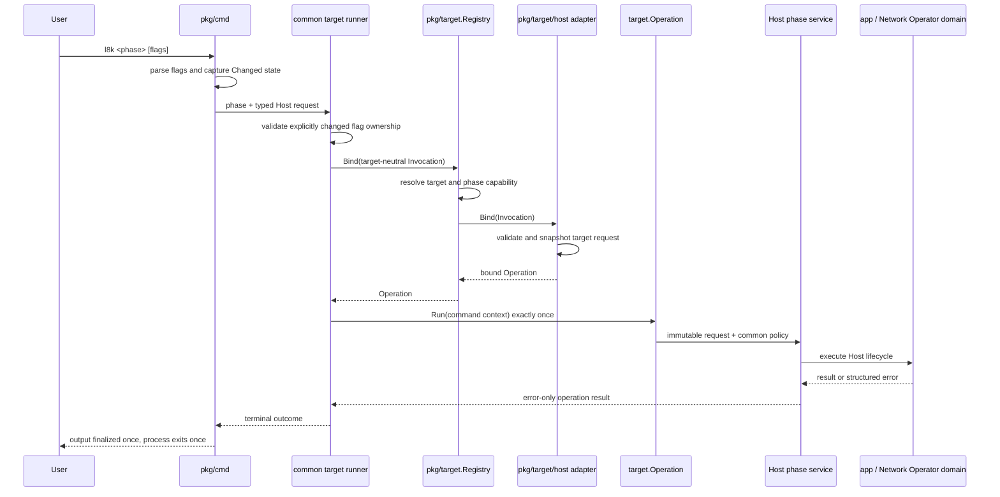
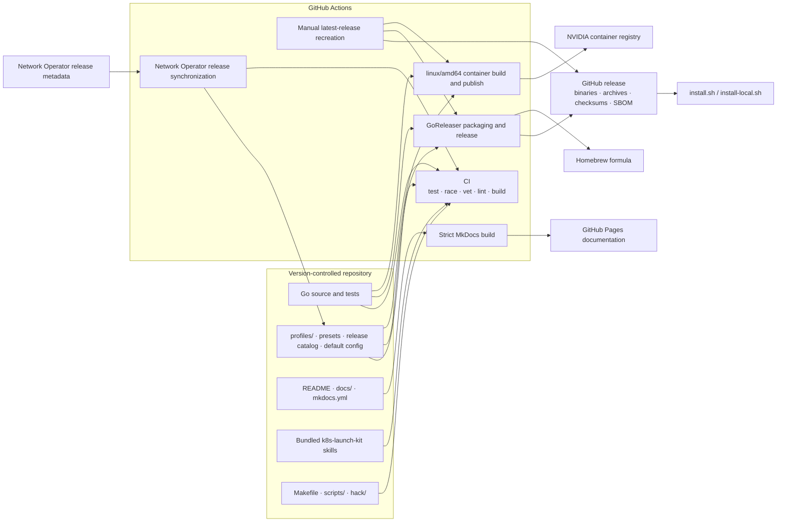

<!--
SPDX-FileCopyrightText: Copyright 2026 NVIDIA CORPORATION & AFFILIATES
SPDX-License-Identifier: Apache-2.0
-->

# Launch Kit architecture

This page is the canonical architectural map of Kubernetes Launch Kit. It
documents the repository boundaries, lifecycle data flow, external systems,
and the target extension seam. Pull requests that change any of those areas
must update this page in the same change.

The [DPF integration roadmap](dpf-integration-plan.md) describes work in
progress. The [HostTarget migration plan](host-target-migration-plan.md) is
retained as implemented design history. Neither is a customer deployment guide.

## Complete component map

The Host artifact boundary is described in [Artifact bundle](artifact-bundle.md).
Generation, deployment, preflight, validation, connectivity, and reporting
consume its validated snapshot; each keeps its own operational policy.

```mermaid
flowchart TB
    actor["Operator / automation / AI agent"]

    subgraph process["l8k process"]
        main["main.go"]

        subgraph cli["CLI and process boundary — pkg/cmd"]
            cobra["Cobra command tree"]
            lifecycle["discover · generate · deploy · validate · root pipeline"]
            auxiliary["clean · sosreport · preset · schema · version"]
            flags["Flag groups, target ownership, explicit-value capture"]
            runner["Common target runner\nbind once · Run(ctx) once · exit once"]
        end

        subgraph targetcore["Target-neutral runtime — pkg/target"]
            registry["Registry + capability descriptors"]
            invocation["Invocation\nphase · output policy · dry-run · timeout"]
            operation["Operation.Run(context)"]
        end

        subgraph targets["Target implementations"]
            subgraph host["HostTarget — pkg/target/host"]
                hostadapters["Typed immutable phase adapters"]
                launchersvc["Discover / generate / pipeline runner"]
                deploysvc["Standalone deploy service"]
                validatesvc["Standalone validate + report service"]
                hostpaths["Host config, kubeconfig, preset, artifact resolution"]
            end
            dpf["DPF — pkg/target/dpf + pkg/dpf\nexplicit Redfish / SSH inventory + profiles\nretained HBN generation + standalone deployment"]
        end

        subgraph application["Host application orchestration"]
            launcher["pkg/app Launcher\nworkflow state · JSON result · context"]
            opts["pkg/options\nHost CLI option model"]
            config["pkg/config\nschema · defaults · YAML presence"]
            resolve["pkg/resolve\nconfig precedence + resolved validation"]
            cfgoverrides["pkg/configflags\noption tags · bindings · explicit inputs"]
            configinput["pkg/configinput\nexplicit CLI values + typed requests"]
            assets["pkg/assets\nconfig-dir and installed assets"]
            profiles["pkg/profiles\nprofile metadata and matching"]
            presets["pkg/presets + pkg/presetmatch\ncertified topology catalog and drift"]
        end

        subgraph netop["Network Operator domain — pkg/networkoperatorplugin"]
            plugin["plugin.Plugin implementation"]
            discovery["Discovery\nbootstrap daemon · inventory · grouping · node labels"]
            rendering["Generation\nprofile selection · templates · render plan"]
            releases["Embedded release catalog"]
            spectrumx["Spectrum-X addressing and config"]
            deploy["Deployment state machine\nHelm · preflight · phased apply"]
            validation["Static validation\nrelease · components · manifests · drift"]
            connectivity["Connectivity validation\nICMP · rping · ib_write_bw · GPUDirect"]
            crstate["Per-Kind reconciliation registry"]
            daemon["pkg/nicconfigdaemon\nembedded discovery workload"]
        end

        subgraph platform["Shared runtime services"]
            kubeclient["pkg/kubeclient\ncontroller-runtime client · REST config · pod exec"]
            ui["pkg/ui\ntext · quiet · JSON · progress"]
            errors["pkg/errors\nstructured errors · reported output · exit status"]
            logging["pkg/log"]
            firmware["pkg/fwresolver"]
        end
    end

    subgraph artifacts["Host artifacts and embedded inputs"]
        clusterconfig["cluster-config.yaml"]
        deploymentfiles["deployment/network-operator/\noptional values.yaml + ordered manifests"]
        report["k8s-launch-kit-validation-report.html"]
        profiledata["profiles/ · presets/ · release catalog · default config"]
    end

    subgraph cluster["Kubernetes host cluster"]
        api["Kubernetes API server"]
        helm["Network Operator Helm release"]
        operators["Network Operator and managed controllers"]
        crs["NCP · NNP · NIC config · SR-IOV · secondary-network CRs"]
        workloads["Discovery and validation DaemonSets"]
        hardware["Worker nodes · NICs · GPUs · RDMA devices"]
    end

    external["External image, firmware, and preset sources"]
    dpfoperator["DPF Operator / tenant Kubernetes / DPU agents + HBN"]

    actor --> main --> cobra
    cobra --> lifecycle
    cobra --> auxiliary
    lifecycle --> flags --> runner
    runner --> registry
    runner --> invocation
    registry --> hostadapters
    registry -->|typed DPF standalone phases| dpf
    hostadapters --> operation
    invocation --> operation
    operation --> launchersvc
    operation --> deploysvc
    operation --> validatesvc

    launchersvc --> launcher
    launchersvc --> hostpaths
    deploysvc --> hostpaths
    validatesvc --> hostpaths
    launcher --> opts
    launcher --> config
    launcher --> resolve
    launcher --> assets
    launcher --> profiles
    launcher --> presets
    launcher --> plugin

    flags --> cfgoverrides
    hostpaths --> resolve
    resolve --> cfgoverrides
    resolve --> configinput
    resolve --> config
    cfgoverrides --> opts
    plugin --> discovery
    plugin --> rendering
    plugin --> deploy
    discovery --> daemon
    discovery --> presets
    discovery --> kubeclient
    rendering --> releases
    rendering --> spectrumx
    rendering --> profiles
    deploy --> releases
    deploy --> crstate
    validation --> releases
    validation --> crstate
    validation --> presets
    validatesvc --> validation
    validatesvc --> connectivity
    connectivity --> kubeclient
    deploysvc --> deploy

    hostpaths --> clusterconfig
    discovery --> clusterconfig
    clusterconfig --> rendering
    profiledata --> assets
    profiledata --> profiles
    profiledata --> presets
    profiledata --> releases
    rendering --> deploymentfiles
    deploymentfiles --> deploysvc
    deploymentfiles --> validatesvc
    validatesvc --> report

    kubeclient --> api
    deploy --> helm
    helm --> operators
    api --> operators
    api --> crs
    api --> workloads
    discovery --> workloads
    connectivity --> workloads
    workloads --> hardware
    crstate --> crs
    firmware --> external
    releases --> external
    presets --> external

    launcher --> ui
    deploysvc --> ui
    validatesvc --> ui
    launcher --> errors
    deploysvc --> errors
    validatesvc --> errors
    runner --> errors
    process --> logging

    dpf -->|retained plan + native API clients| dpfoperator
```



The diagram distinguishes three boundaries that should remain stable:

1. `pkg/cmd` parses Cobra state and owns process termination.
2. `pkg/target` carries only policy whose meaning is identical for every
   target.
3. `pkg/target/host` owns Host-specific requests, configuration lookup, and
   lifecycle services. Network Operator remains a Host-internal plugin rather
   than a target abstraction.

## Lifecycle and artifact flow



The legacy root command composes `discover → generate → optional deploy` in one
Host operation. Validation deliberately remains a separate phase.

`networkOperator.skipHelmChart` is a Host-specific lifecycle switch routed by
`--skip-network-operator-helm`. It removes the `values.yaml` artifact and
bypasses the Helm install/version/values/uninstall edges, while preserving the
Network Operator manifest, component-version, stray-resource, data-plane, and
custom-resource cleanup paths. Cleanup reads the persistent config setting to
avoid removing a release owned by another system.

Config-backed Host flags are described by tags on `pkg/options.Options` and
bound through `pkg/configflags`. `pkg/configinput` carries explicit CLI values
and coordinated resolver requests. `pkg/config.Input` retains YAML presence so
explicit false, zero and empty values remain distinguishable from omitted fields. `pkg/resolve` combines canonical defaults, hardware defaults, user
values and explicit CLI inputs, then applies release and flavor rules and
validates the result. Coordinated inputs use typed resolver requests.

Discover, generate, standalone deploy and standalone validate use this shared
resolution path. The Network Operator plugin retains compatibility helpers;
it does not own a separate canonical flag-to-config registry. `l8k schema`
exposes the same bindings as `flags[].configPaths` for automation.

## Target binding and execution



Selecting `dpf` binds its independent discovery, generation or standalone deploy
adapter. The deploy adapter validates a retained bundle and explicit site access.
Before discovery probes or cluster effects, it verifies bounded anonymous HTTPS
manifest/config metadata for the exact retained HBN image, permitting only
same-origin anonymous Bearer token exchange. Kubelet pull credentials are a
separate authority. Each resume repeats this prerequisite, and runtime resolves
metadata afresh; an early identity is not a future-pull or traffic receipt. It
then refreshes prerequisites and runs management, tenant, enrollment, software,
workload declarations, activation, host networking and native HBN runtime checks.
It never enters a Host lifecycle service. DPF standalone validation and the root
pipeline remain capability rejections before client construction.

DPF deploy reserves one typed, nonsecret ConfigMap checkpoint in the existing
operator namespace before DPUDeployment creation. `--resume` binds its exact
namespace/name/UID and retained plan, reconstructs verified prerequisite receipts,
and restores activation history. One deployment-local owner records named parent,
hold, reset and host-network transitions. Stages receive detached purpose-specific
views; current API and physical verification stays with each stage. Persistence
uncertainty stops new effects for the entire attempt, including repeated transition
paths. Conditional patches, immutable reset claims and
host-local transaction journals retain ownership of their individual effects;
the checkpoint does not provide physical fencing or automatic adoption. Existing
claims select observation-only recovery. A lost reset-ACK completion response
requires the same immutable claim and fresh selected controller/Arm/host proof
before recording controller advancement; a missing or replaced claim blocks
recovery. An acknowledged reset permanently closes its phase-bound logical
request; a reappeared pending annotation cannot renew reset or ACK authority.
Physical reset observations matching saved history, and host-local results,
remain visible through later checkpoint failures. Rejected reset observations
never enter the reboot summary. Completed host work is inspected
without configuration fallback. Each attempt produces fresh runtime evidence.

DPF deployment stages consume their own read/check ports and the effects needed
by that stage; they do not inherit prior stages' installers or writers. Management
and tenant access remain separate identity domains. Tenant readers own child,
allocation, permission and runtime Pod observations directly, without exposing
upstream client factories. Runtime receives copied verification data and narrow
management/tenant readers, plus explicit bounded command, traffic and image I/O.
Its inputs and lease closure retain no operation store, first-create callback,
installer, selector/activation patcher, resetter or host configurer. The retained
plan, bundle and compiled schemas remain immutable data owners.
Private I/O composition may select a typed request limiter before native client
construction for deterministic transport tests. Ordinary application calls pass
nil and preserve client-go pacing, credentials, TLS and request controls; the
limiter does not replace a client, request or verification result.

DPF runtime measurement uses a resource/allocation fence distinct from the full
physical mutation fence. Both share management, tenant, workload/software,
credential and complete selected-resource verification. The physical wrapper
preserves its ordering around BMC identity/Administrator collection; host
configuration and reset paths keep that wrapper. Runtime performs it at phase
entry and before final acceptance, with a final pod/allocation observation after
the physical exit read. Every measurement retains fresh complete resource,
lease, pod/container/image and host/PF/route checks; no successful observation is
cached across measurements.

Each prepared DPF execution owns its retained CRD expectations and their immutable
default-normalized spec JSON. Desired normalization runs once at construction;
every fresh live CRD still undergoes full typed/default normalization and complete
spec comparison, alongside identity, metadata, readiness and scope checks. Live
observations are never cached by UID or generation.

## Deployment and validation internals


Host deployment selects a concrete `kubernetesDeploymentPolicy` or
`openShiftDeploymentPolicy` from the operation's explicit
`hostplatform.Selection`. The six-method, internal `deploymentPolicy` boundary
owns artifact classification, platform prerequisites, bootstrap, preflight,
post-preflight configuration and dependent-API retry eligibility. Kubernetes
bootstrap retains managed/external Helm ownership and the pre-Helm overwrite
removal check. OpenShift requires external OLM operators and configures them only
after preflight, with the sysctl allowlist checked before other operator writes.
Both use the same apply, fresh observation, target-scope and reapply loops.

The separate two-method `resourceReadPolicy` has concrete Kubernetes/OpenShift
implementations. It supplies the existing `crstate` readiness registry to deploy
and performs standalone resource checks, including OpenShift's generated NAD
check. It exposes no deployment effects. Kind-specific operator configuration
validation still runs on either platform. Rendering, connectivity and cleanup
retain their existing owners.

This split preserves existing policy differences: OpenShift deploy still executes
stray-resource scans before filtering their results. Standalone OpenShift
validation skips Helm checks and does not perform the comprehensive OLM
prerequisite gate used by deploy. These retained differences are not new
qualification claims; static validation also lacks deploy's apply-history gate.

```mermaid
flowchart TB
    subgraph deployflow["Host deploy"]
        d0["Resolve config, manifests, kubeconfig"]
        d1["Phase 0: optional Helm install / upgrade"]
        d05["Phase 0.5: drift and stray-resource preflight"]
        d2["Phase 1: NicClusterPolicy + readiness"]
        d3["Phase 2: NicNodePolicies + per-policy readiness"]
        d4["Phase 3: batch remaining manifests"]
        d5["Phase 4: verify terminal reconciliation state"]
        d0 --> d1 --> d05 --> d2 --> d3 --> d4 --> d5
    end

    subgraph validateflow["Host validate"]
        v0["Resolve config, manifests, kubeconfig, preset catalog"]
        v1["Optional Helm release/values, component versions, stray CRs"]
        v2["crstate manifest classification"]
        v3{"Static state terminal?"}
        v4["Connectivity matrix and optional GPUDirect DMA-BUF"]
        v5["Aggregate verdict and warnings"]
        v6["Write synchronous HTML report"]
        v0 --> v1 --> v2 --> v3
        v3 -->|ready| v4 --> v5
        v3 -->|missing / error / in-progress| v5
        v5 --> v6
    end
```



## Package ownership

| Boundary | Owns | Must not own |
| --- | --- | --- |
| `pkg/cmd` | Cobra declarations, target flag ownership, request construction, final process exit | Host cluster orchestration or DPF configuration |
| `pkg/target` | Names, phases, capabilities, common invocation policy, registry, operation contract | Cobra, Host options, DPF options, Kubernetes clients |
| `pkg/target/host` | Typed Host requests, explicit-value semantics, Host path/config resolution, phase services | DPF implementation or cross-target composition |
| `pkg/app` | Discover/generate/root workflow state and Network Operator plugin coordination | CLI parsing or process exit |
| `pkg/dpf/app` | Discover, generate and deploy operation composition; pure generation/retained-plan resolution, explicit access and artifact I/O, collectors and permission checks, publication and external reboot composition | CLI binding, process signals, final output or deployment state machine |
| `pkg/dpf/managementaccess` | Bounded explicit management credential/TLS snapshots, client construction and fresh cluster identity reads | Discovery inventory, deployment eligibility, ambient Host kubeconfig fallback or cached identity success |
| `pkg/dpf/discovery` | Expanded management inventory, provisioning observations and discovery checks using explicit management access | Credential loading or base management access construction |
| `pkg/networkoperatorplugin` | Discovery, rendering, deployment state machine, validation primitives | Target selection |
| `pkg/config`, `pkg/options` | Host configuration, YAML presence and option models | A universal union of Host and DPF configuration |
| `pkg/configflags`, `pkg/configinput`, `pkg/resolve` | Shared option bindings, explicit CLI inputs, configuration resolution and validation | CLI process exit or cluster orchestration |
| `pkg/ui`, `pkg/errors`, `pkg/log` | Presentation, structured failures, and logging | Domain decisions |

DPF adapters call `app.Discover`, `app.GenerateBundle` and `app.Deploy` with
typed requests and context. Adapters retain signals, writers, progress policy,
user-facing error projection and final output. Generation's public-file loading,
chart retrieval, rendering and publication are explicit I/O, separate from pure
`app.ResolveGeneration`. Fresh generation selects maintained release defaults;
retained deployment uses the validated plan's fixed recipe and compares current
settings, source selection and exact physical bindings against it. Deployment
validates the bundle and retained plan before opening access. A preparation error
has no execution result; once `deployment.Run` starts, its typed outcome is
available even on failure. Deployment retains the lifecycle state machine and
all effect fences. The application composes the bounded external SSH rebooter,
including its one-submission and observation-only recovery behavior.

The application shares concrete collector assembly across standalone discovery
and native deployment prerequisite collection. Standalone discovery selects fresh
permission planning and release-dependent BMC observations; deployment binds
authorization and provisioning to its retained plan. Resume defers lifecycle
eligibility, and post-activation additionally records artifact inputs without
re-reading origin bytes. Each collection keeps its own probe journal. Both
standalone discovery and prerequisite publication retain their existing bounded
cancellation-independent publication budgets. Caller authorization uses the
actual generated or retained bundle and fresh management identity.

DPF discovery, probes and deployment share the concrete management access client.
Each `managementaccess.Open` snapshots the explicit bounded credential and TLS
references at its existing call boundary; identity observations make fresh remote
reads through that snapshot. Discovery owns expanded inventory and provisioning
observations. Generation retains access references without opening credentials.

## Build, release, and documentation supply chain



The packaged binary embeds its default configuration, profile templates,
topology presets, release catalog, and discovery workload. A release or sync
change therefore belongs in this architecture even when it does not modify a
runtime Go package.

The manual `recreate-latest-release.yml` workflow replaces GitHub's latest
release and its tag at the selected commit, preserving their names and generating
new release notes. It dispatches the existing binary and image workflows at that
tag; their completion is separate from release recreation. See the
[maintainer procedure](https://github.com/NVIDIA/k8s-launch-kit/blob/main/CONTRIBUTING.md#recreate-the-latest-release)
for effects, prerequisites and recovery.

## Go discovery library

The Helm-free `pkg/networkoperatorplugin/discovery` package is the Go entry
point for applications that need Launch Kit's hardware inventory without the
CLI. It bootstraps the discovery daemon, fills a `*config.LaunchKitConfig`, and
writes the `nvidia.kubernetes-launch-kit.machine` and `.gpu` labels. It also
patches an existing `NicClusterPolicy` when needed; the call changes cluster
state. See [Cluster Discovery](../../docs/user/discovery.md) for prerequisites and
bootstrap effects.

After creating a controller-runtime `client.Client` and matching
`*rest.Config`, a caller can use the embedded defaults:

```go
import (
    "path/filepath"

    l8kconfig "github.com/nvidia/k8s-launch-kit/pkg/config"
    l8kdisc "github.com/nvidia/k8s-launch-kit/pkg/networkoperatorplugin/discovery"
)

cfg, err := l8kconfig.DefaultLaunchKitConfig()
if err != nil { return err }

cfg, err = l8kdisc.Discover(ctx, kubeClient, restConfig, cfg,
    l8kdisc.WithRelease("26.4"),
    l8kdisc.WithPresetsDir(filepath.Join(configDir, "presets")),
)
if err != nil { return err }
```

The release option is optional; otherwise the supplied config's release is
used. `WithPresetsDir` selects one authoritative catalog for this call; it does
not merge with embedded presets. To load a filesystem config first, call
`l8kconfig.LoadFullConfig(path, logger)` and pass the result to `Discover`.
`Discover` mutates that config in place and returns the same pointer. Use a
non-nil REST config for the normal CLI-equivalent NIC probe path; a nil REST
config uses a reduced library fallback, including label-based node filtering.

`WithLogger` routes discovery logs through a caller-supplied `logr.Logger` by
setting controller-runtime's process-global logger. Coordinate its use if
other goroutines configure logging concurrently. The release catalog is in
`pkg/networkoperatorplugin/releases` (`LookupRelease`, `SupportedReleases`).
The deploy and validation entry points are in the parent
`pkg/networkoperatorplugin` package.

For new per-PF host probes, extend the batched sysfs path in
`pkg/networkoperatorplugin/discovery/gputopology.go`: `pfDiscoveryProbeCmd`,
`parsePFDiscoveryBlock`, and `applyPFDiscoveryAttributes`. NUMA is persisted
per PF; MACs are used transiently for the group's netplan decision.

## Updating this architecture

Update this page whenever a pull request changes any of the following:

- lifecycle commands, target names, phase capabilities, or flag ownership;
- package ownership or an import direction shown above;
- `cluster-config.yaml`, generated artifact, or report layout;
- discovery, render, deployment, or validation ordering;
- Kubernetes, Helm, registry, firmware, or other external boundaries;
- build, release, packaging, documentation, or embedded-input flows;
- a new target implementation or cross-target environment composer.

When changing repository-root configuration defaults, run
`go generate ./pkg/config` to refresh the embedded copy. The configuration
tests check that the generated bytes match `cluster-config.yaml`. Config-backed
flags are declared on `options.Options` with command-scope tags; coordinated
inputs such as release and Spectrum-X configuration use typed resolver requests.

The PR author should check the component map, lifecycle flow, binding sequence,
deployment/validation flow, package ownership, and delivery supply chain. If a
diagram node is renamed, moved, added, or removed, update its adjacent edges in
the same commit. Keep implementation plans separate from this page: this
document describes the current architecture, while files such as the
[DPF integration roadmap](dpf-integration-plan.md) describe intended changes.
